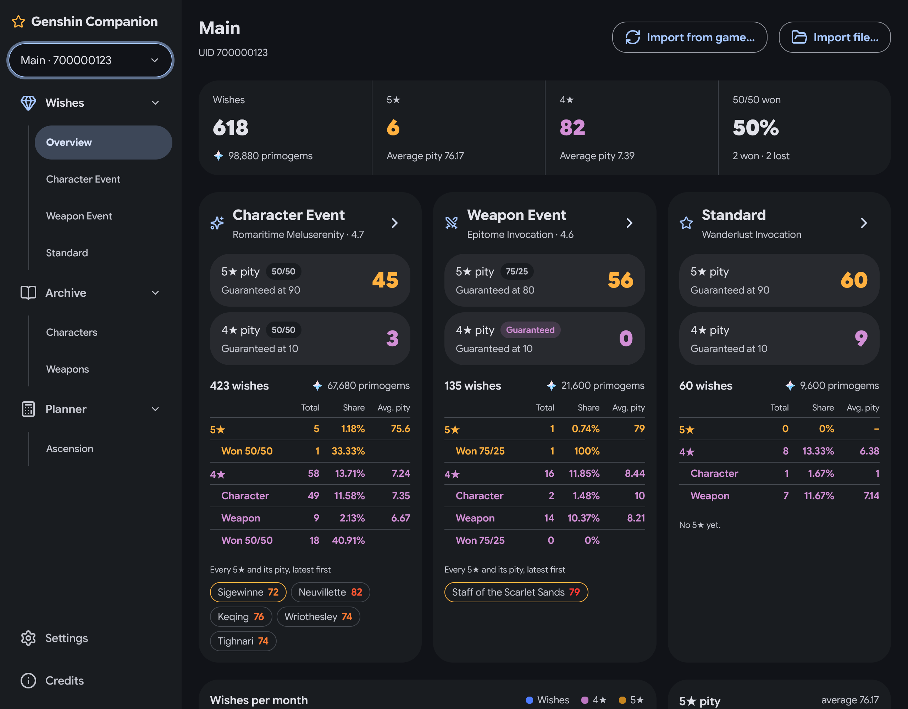
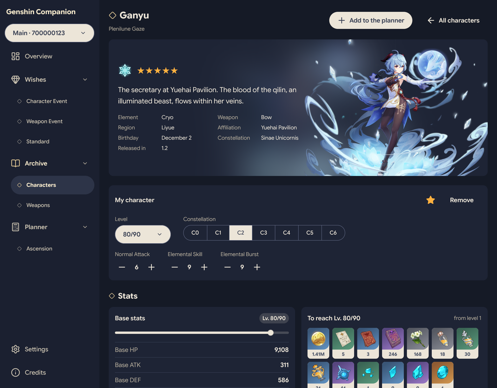
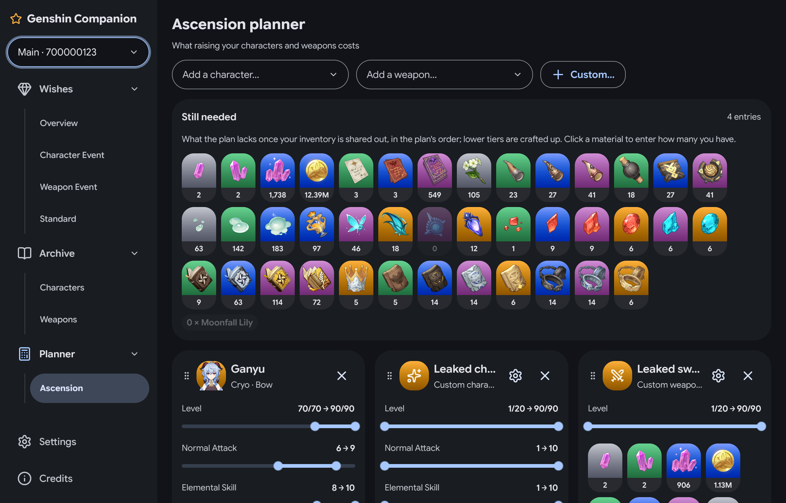

# Genshin Companion

A desktop companion for Genshin Impact: a wish counter that never loses your history, a character archive
and an ascension planner. It runs on Windows, macOS and Linux, is written in Rust with
[GPUI](https://www.gpui.rs) (through [GPUI Kit](https://gpui-kit.com)). Your data stays on your computer.

The wish counter is a desktop remake of [paimon.moe](https://paimon.moe)'s, and gives the same numbers. The
difference is where the data lives. paimon.moe keeps your history in the browser, where clearing site data
erases it. HoYoverse's API only returns the last six months, so wishes older than that exist nowhere else.
Here they live in a database on your disk, with backups.

[Download it](#download) for Windows, macOS or Linux, or [build it yourself](#building-from-source).



## Features

### Overview

The app opens on your account in figures, one tab each:

- **Wishes:** key figures, then a card per banner type: its pity and the odds of the next 5★ and 4★, then a
  summary (share, average pity, 50/50 record, 4★ characters against 4★ weapons, every 5★ with its pity). Below
  them, wishes per month and the pity of each 5★.
- **Characters:** how many of the game's characters you own, by rarity, element and weapon, then your
  constellations, characters at level 90 and talents at level 10.
- **Weapons:** how many of the game's weapons you own, by rarity and type, then each of your 5★ and 4★ with its
  refinement, its copies and the characters holding them.

### Wish counter

- Pity, 50/50 and guarantees for every banner type, computed exactly as paimon.moe does. The Character Event
  banners share their pity.
- A history you can sort, with each wish's banner and its number on that banner, and a view per banner.
- Counting by hand (+1, +10, one 4★ or 5★), like paimon.moe's manual mode, turned on in Settings.

### Imports and exports

- **From the game.** The app finds the wish history link in the game's cache (Windows, or a Wine/Proton prefix
  on Linux), or you paste it. It then asks HoYoverse's API directly, with no proxy in between. Phone and console
  players can copy the link on their device and paste it here.
- **From a file:**
  - a paimon.moe save (JSON) or spreadsheet (Excel);
  - a [UIGF](https://uigf.org) v4 file from another tracker;
  - this app's own snapshot.
- **Characters from HoYoLAB.** Your characters as they are in the game (level, constellations, talents) and the
  weapon each holds, into your collection: it only adds or raises, never lowers, and shows what would change
  first. It reads them with your HoYoLAB cookie, which you copy from the browser (F12 → Storage → Cookies →
  hoyolab.com: `ltuid_v2`, `ltoken_v2`, `ltmid_v2`) for that sync only: the app never saves it and sends it to
  HoYoverse only. HoYoLAB doesn't show the weapons in your bag, nor your materials, nor whether a character at a
  level cap ascended (counted as not yet).
- **Exports:** the lossless snapshot, UIGF v4 and paimon.moe's spreadsheet.
All of these are on the Import page; the wish imports are also on the Overview.

### Your history is never lost

- Imports only add wishes. Nothing already stored is replaced or deleted, so importing the same file twice is safe.
- A backup of the database is taken before every import, undo, restore or bulk change, and once a day; the last
  30 are kept. Counting by hand and editing the plan back up once an hour, and the last 10 of those are kept apart,
  so they never push out the others. A backup can be restored from Settings: it replaces everything, the plan and
  the inventory too, after a backup of the current state.
- Every imported file is kept as it was received.
- Every import can be undone, from Settings → Recent imports.
- A **mirror folder** (optional): after every change, a snapshot of your history is written to a folder that you
  sync with your own tool, such as Syncthing or a cloud drive. It holds your UID and wishes, so a synced folder
  sends them to that service. Give each computer its own mirror folder: the file has one name, and two computers
  writing it would replace each other's copy.

### Character and weapon archive

Every character, like [Project Amber](https://gi.yatta.moe)'s archive. The characters you have come first, with
their level and constellation on the card; add or remove them from the list, and mark favourites. Search, filter
(element, weapon, rarity, favourites) and sort the list. Each character's page shows, one section after another:

- **My character:** the level, constellation and talents you have, when you have the character.
- **Stats:** at any level and ascension phase, and the materials needed to get there.
- **Ascension:** the stats at each ascension.
- **Talents:** values at any talent level.
- **Constellations.**

Every weapon too, the ones you have first (with their best refinement and how many copies), filtered by type,
rarity and favourites. A weapon's page lists your copies (level, refinement, the character holding it) above
its ATK and secondary stat at any level, what reaching it costs, and its passive at each refinement.

### Ascension planner

Like [genshin-center](https://genshin-center.com/planner)'s planner.

- Pick a character or a weapon among the cards (yours first; a character you own starts from your levels), then set
  the level (and a character's three talents) from where they are to where you want them.
  The materials are shown for each character and for the whole plan, with EXP as Hero's Wit (or Mystic Enhancement
  Ore for weapons) and its Mora.
- **Inventory:** click a material to enter how many you have, or add what a domain run just gave you. What you
  have goes to the characters in the plan's order (drag a card by its header to change it): each card shows what its character still lacks once the ones
  before it have taken their share, and "Still needed" what the whole plan lacks. A tier you lack is crafted from
  the tiers below, three for one, as at the alchemy table (a flask badge on a material says how many are
  crafted, as on genshin-center), and EXP books count for their EXP. The dialog shows the
  whole series (or the three books under Hero's Wit) with what the plan needs, crafts and still lacks of each, as
  you type.
- A **custom character or weapon** covers one the game data doesn't have yet, such as a leak: give it a name,
  its stars and its materials (a character's six: common, local specialty, boss, gem, talent book, weekly boss;
  a weapon's three: domain material, elite and common drops), picked from the game's or typed by name. It then
  costs what any character, or weapon of its stars, costs.

<p>
  
  
</p>

## Download

The builds are on the [Releases](https://github.com/Deltouille/genshin-companion-rust/releases) page. Unpack the
archive for your system and start the app: there is nothing to install.

- **Windows** (`…-windows-x86_64.zip`): `genshin-companion.exe`. The build isn't signed, so SmartScreen may warn
  before the first launch: choose *More info*, then *Run anyway*.
- **macOS 11 or later** (`…-macos-apple-silicon.zip`, or `…-macos-intel.zip` for an Intel Mac):
  `Genshin Companion.app`. It is signed ad hoc, not by a developer account, so macOS refuses to open it the first
  time: open System Settings → Privacy & Security and choose *Open Anyway*.
- **Linux** (`…-linux-x86_64.tar.gz`): `genshin-companion`, built on Ubuntu 22.04, so it needs glibc 2.35 or later.
  It also needs fontconfig, freetype, libxkbcommon, Wayland, libX11, libxcb and the Vulkan loader, which desktop
  systems usually have.

`SHA256SUMS.txt`, beside the archives, holds their checksums (`sha256sum -c SHA256SUMS.txt --ignore-missing`).
To update, replace the app with the newer one: your data lives in its own folder (below), not beside the app.

## Your data

Everything stays in one folder:

| System  | Folder                                            |
|---------|---------------------------------------------------|
| Linux   | `~/.local/share/genshin-companion`                |
| Windows | `%APPDATA%\genshin-companion\data`                |
| macOS   | `~/Library/Application Support/genshin-companion` |

```text
wishes.db       the database, the one source of truth
backups/        automatic backups of the database
imports/        a copy of every imported file, as received
game-data/      optional newer game data (see below)
cache/images/   the game's images, downloaded the first time they're shown
settings.json   this computer's preferences
```

Settings shows this folder and can open it in your file manager. To run the app on another folder, for example
to try something on a copy, set `GENSHIN_COMPANION_DATA_DIR=<folder>`. One copy of the app at a time can use a
folder; starting a second one says the app is already open.

If the app can't start, it says why in a small window and in `genshin-companion-errors.txt` in the system's
temporary folder, where crashes are written too.

The app used to be called *Genshin Wishes*. On its first start under the new name, it copies the old
`genshin-wishes` folder to `genshin-companion` and then uses the copy. The old folder is left as it was: delete it
yourself once you've checked that everything is there.

The app goes online for two things only:

- importing from the game, through HoYoverse's API;
- downloading the game's images the first time a page shows them, from the fan sites that already serve them:
  paimon.moe (item icons, banner art) and Project Amber (everything else). They are kept in `cache/images/`, so
  each is downloaded once. Without a connection, pages show an empty space where an image would be. To use the
  app offline, Settings → Images downloads them all at once: every icon (about 35 MB), or everything with the
  banner and wish art (about 350 MB). It can also empty the cache.

Like any website, these sites see your IP address and which files are asked for. The app sends nothing about you or
your wishes anywhere. It is an unofficial tool: it reads the game's files without changing them and asks
HoYoverse's API what the game's own history page shows, but using it is your choice.

## Building from source

You need stable Rust (edition 2024).

- **Windows and macOS:** run `cargo run --release -p wish-app`.
- **Linux:** GPUI loads its window and GPU libraries when it starts. You need fontconfig, freetype, libxkbcommon,
  Wayland, libX11, libxcb and the Vulkan loader. With Nix, `nix develop` opens a shell that has them all.

```sh
nix develop                     # Linux, with Nix
cargo run --release -p wish-app
```

The binary is `target/release/genshin-companion`, and needs no other files. It contains none of the game's images:
the app downloads them as it needs them (see [Your data](#your-data)).

## Updating the game data

The game data is generated from other projects, then committed:

| File | Content | Generated from |
|---|---|---|
| `crates/wish-core/data/items.json`, `banners.json` | Banners and items | paimon.moe |
| `crates/wish-core/data/planner.json`, `archive.json` | Planner and archive data | genshin-db |

```sh
# Banners and items, from a paimon.moe clone in reference/
git clone https://github.com/MadeBaruna/paimon-moe reference   # or: git -C reference pull
node tools/extract-paimon-data.mjs

# Planner and archive, from a sparse genshin-db clone in genshin-db/
git clone --depth 1 --filter=blob:none --sparse https://github.com/theBowja/genshin-db
git -C genshin-db sparse-checkout set src/data/English/characters src/data/English/talents \
  src/data/English/weapons src/data/English/materials src/data/English/constellations \
  src/data/image src/data/stats src/data/curve src/data/version
node tools/extract-genshin-db.mjs

```

Newer data can also be added without rebuilding the app. Put `items.json`, `banners.json`, `planner.json` or
`archive.json` in the data folder's `game-data/`. A planner file whose costs name an unknown material is refused.

## Development

The workspace has three crates, and each one depends only on the one after it:

- `wish-app` is the window.
- `wish-ui` is the design system: theme, fonts, icons and shared components.
- `wish-core` holds the logic and the tests: data, storage, imports, the pity engine and the planner. It never
  depends on GPUI.

```sh
cargo test --workspace
cargo clippy --workspace --all-targets -- -D warnings
cargo fmt --all

# Command-line import, export and summary (use --data-dir to keep away from your real data)
cargo run -p wish-core --example wishctl -- --data-dir /tmp/scratch summary

# Offscreen screenshots of every page, and a gallery of every component
cargo run -p wish-app --example screenshot -- <data-dir> <out-dir>
cargo run -p wish-ui --example gallery -- <out-dir>

# After changing Cargo.lock: the licences of every dependency, shown in the app and
# shipped in the release archives (needs cargo-about; CI checks the file is current)
tools/third-party-licenses.sh
```

CI runs fmt, clippy, the tests and a release build on Linux, Windows and macOS, checks that
`THIRD-PARTY-LICENSES.txt` is current, and audits the dependencies for known vulnerabilities (cargo-deny) on every
push and every week.
[`CLAUDE.md`](CLAUDE.md) holds the conventions.

To publish a release, set the version in the workspace's `Cargo.toml`, write the release notes in
`docs/releases/v<version>.md`, commit, then push a tag of that version:

```sh
git tag v0.1.0
git push origin v0.1.0
```

`release.yml` then runs the CI and the audit again, builds each system's archive from `Cargo.lock` without a cache
(`tools/package-release.sh`), and publishes them on the Releases page with `SHA256SUMS.txt`, the notes and GitHub's
list of changes. A tag that doesn't match the version publishes nothing.

## Credits

- [paimon.moe](https://github.com/MadeBaruna/paimon-moe) by Made Baruna. The wish counter is a remake of its own, and
  its banner and item data come from it. Used under the MIT License.
- [genshin-db](https://github.com/theBowja/genshin-db) by theBowja. The data for the archive and the planner. Used
  under the MIT License.
- [Project Amber](https://gi.yatta.moe): the character, weapon, material, talent and constellation icons, and the
  wish art.
- [AnimeGameData](https://gitlab.com/Dimbreath/AnimeGameData): the EXP each level needs.
- [genshin.py](https://github.com/seriaati/genshin.py) by thesadru and seriaati: the HoYoLAB sync's requests and
  their signing follow it (MIT License).
- [UIGF](https://uigf.org): item ids for UIGF exports.
- [Google Sans Flex](https://github.com/googlefonts/googlesans-flex), under the SIL Open Font License 1.1, and
  [Lucide](https://lucide.dev) icons, under the ISC License.
- [GPUI Kit](https://gpui-kit.com), under the Apache License 2.0.

The full MIT notices are in [`crates/wish-app/licenses/`](crates/wish-app/licenses), and on the app's Credits page.
So is `THIRD-PARTY-LICENSES.txt`, the licence of every open-source crate the app is built with, also in every
release archive.

## Licence

Genshin Companion's code is licensed under the [GNU General Public License v3.0 or later](LICENSE).

Genshin Impact, its characters, weapons, art and all other game content belong to HoYoverse.
They are not covered by this licence. Neither this repository nor the app's builds contain the game's images: the
app downloads them for the player who runs it. Its data files do hold the game's names, numbers and texts
(descriptions of characters, talents, constellations and weapons), as the wikis publish them, so the archive works
offline. Genshin Companion is a fan project. It is not affiliated with or endorsed by HoYoverse.
