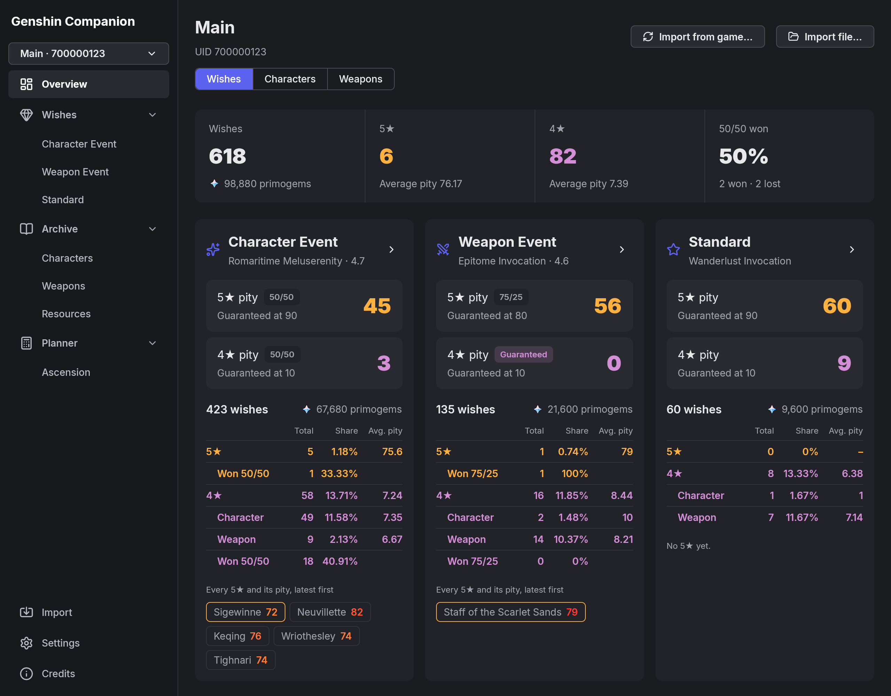
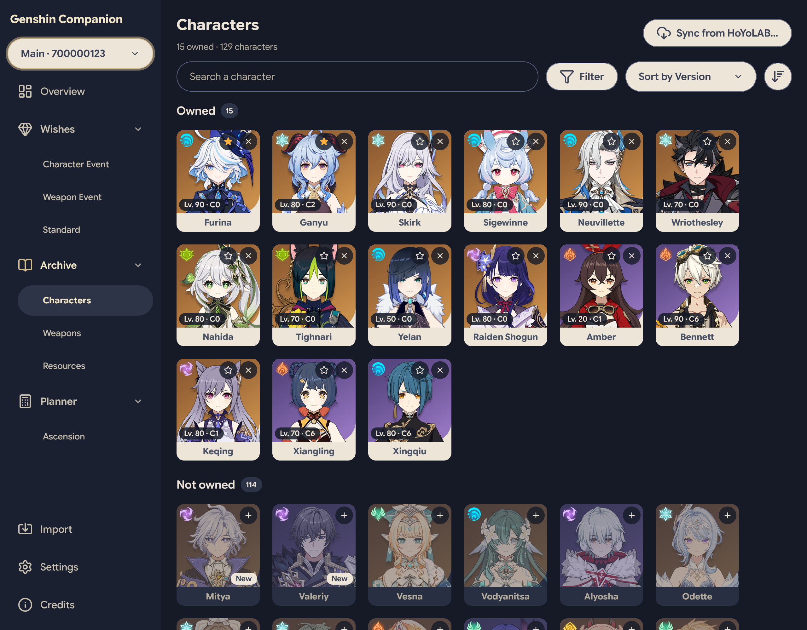
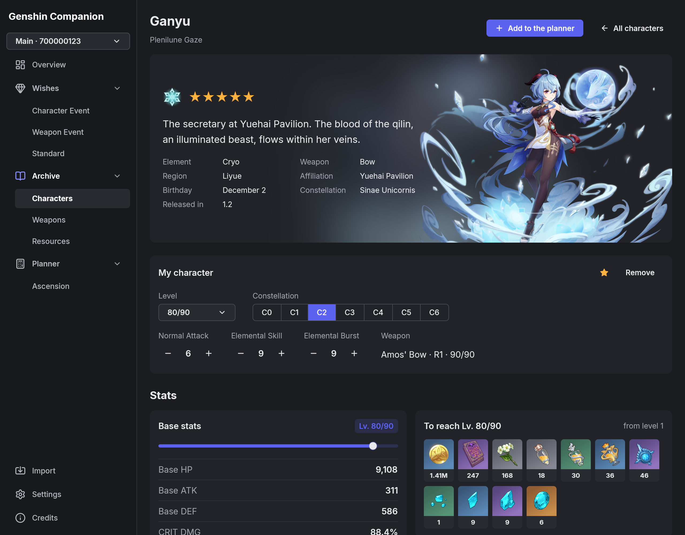
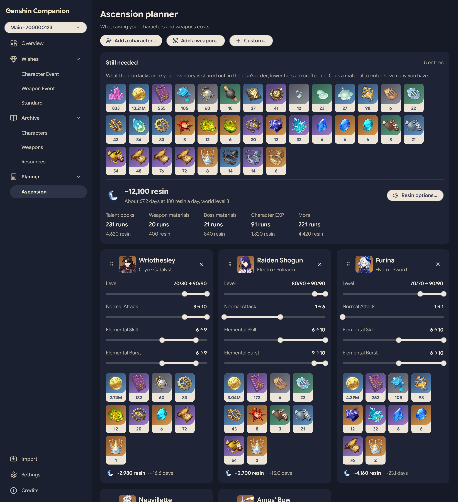

# Genshin Companion

A desktop app for Genshin Impact: it keeps your wish history, shows where your pity stands, and works out what your
characters need to level up. It runs on Windows, macOS and Linux, and is written in Rust with
[GPUI](https://www.gpui.rs).

It started as a desktop take on [paimon.moe](https://paimon.moe)'s wish counter. paimon.moe stores your history in
the browser, so clearing your site data wipes it, and the game itself only shows the last six months. Here the
history goes into a database on your own disk, with backups, and importing never deletes a wish.

[Download it](#download), or [build it yourself](#building-from-source).



## What it does

**Wish counter.** Import your history straight from the game: on Windows (or Linux with Wine or Proton) the app
finds the history link in the game's files, otherwise you paste the link, which also works for phone and console
players. You can also bring in a paimon.moe save, a paimon.moe spreadsheet or a [UIGF](https://uigf.org) file from
another tracker. You then get pity and 50/50 for each banner, with the same numbers paimon.moe would show, a history
you can sort and filter, and a few charts. If you used paimon.moe's manual mode, you can keep counting by hand.

**Archive.** Every character, weapon and material in the game: stats at any level, talents, constellations,
passives, and what each ascension costs. Mark what you own yourself, or fill it in from HoYoLAB or from a GOOD file
(the format [Irminsul](https://github.com/konkers/irminsul),
[Inventory Kamera](https://github.com/Andrewthe13th/Inventory_Kamera) and
[Genshin Optimizer](https://frzyc.github.io/genshin-optimizer/) export). A GOOD file brings your whole bag along:
weapons, materials and all. The overview then counts it up: your characters against those out by each version,
their constellations, levels and talents, by element, weapon and region, and what raising them has cost so far.

**Planner.** Pick characters and weapons, drag the sliders from where they are to where you want them, and you see
what is still missing once your materials are shared out, crafting included, and roughly how much resin everything
will take. Tell it your Battle Pass level and it can count the rewards still to come, its boxes of talent books and
specialties going to the series you pick or to what your plan lacks. It works much like
[genshin-center](https://genshin-center.com/planner)'s planner, and it also handles characters that aren't out yet,
whose materials you fill in yourself.

**Chronicle.** HoYoLAB shows your Spiral Abyss and Imaginarium Theater for the period under way and the one before,
and your Traveler's Diary for three months; then they're gone. Each HoYoLAB sync keeps them here for good: the
Abyss's stars, records and the teams that cleared each chamber; the Theater's acts and their cast; where each month's
primogems came from, day by day and reward by reward. A period that's over never changes once kept, so syncing once
a month misses nothing.

<p>
  
  
</p>



The app is in English and French, including the game's own names and descriptions. It follows your system's
language, and you can change it in Settings.

## Download

Builds are on the [Releases](https://github.com/Deltouille/genshin-companion-rust/releases) page. Unpack the
archive and run the app; there is nothing to install.

- **Windows** (`…-windows-x86_64.zip`): run `genshin-companion.exe`. The build isn't signed, so SmartScreen may
  warn you the first time. Click *More info*, then *Run anyway*.
- **macOS 11 or later** (`…-macos-apple-silicon.zip`, or `…-macos-intel.zip` on an Intel Mac): open
  `Genshin Companion.app`. It isn't signed with a developer account, so macOS blocks it the first time. Go to System
  Settings → Privacy & Security and click *Open Anyway*.
- **Linux** (`…-linux-x86_64.tar.gz`): run `genshin-companion`. It's built on Ubuntu 22.04, so it needs glibc 2.35
  or newer, plus fontconfig, freetype, libxkbcommon, Wayland, libX11, libxcb and the Vulkan loader, which a desktop
  system usually has.

Each release also has a `SHA256SUMS.txt` to check the archives against. To update, replace the app with the new
one: your data lives in its own folder, not next to the app.

## Your data

Everything stays on your computer, in one folder:

| System  | Folder                                            |
|---------|---------------------------------------------------|
| Linux   | `~/.local/share/genshin-companion`                |
| Windows | `%APPDATA%\genshin-companion\data`                |
| macOS   | `~/Library/Application Support/genshin-companion` |

Inside it are the database (`wishes.db`), its backups, a copy of every file you imported, and the game's images
once they've been downloaded. Settings shows the folder and can open it for you.

The app backs up the database before every import and every change that touches a lot of data, and once a day.
Settings lists the backups and can restore one, and a wish import can be undone from there too.

If you want a copy somewhere else, choose a mirror folder in Settings: a few seconds after each change, the app
writes a full snapshot there, which you can sync with Syncthing, a cloud drive or anything else. Keep in mind that
the snapshot contains your UID and your wishes, and give each computer its own folder, otherwise they'll overwrite
each other's file.

To try something without touching your real data, point the app at another folder with
`GENSHIN_COMPANION_DATA_DIR=<folder>`.

If the app won't start, it says why in a small window and writes it to `genshin-companion-errors.txt` in your cache
folder (`~/.cache/genshin-companion/` on Linux, `~/Library/Caches/genshin-companion/` on macOS,
`%LOCALAPPDATA%\genshin-companion\cache\` on Windows).

The app used to be called Genshin Wishes. The first time the new version starts, it copies the old
`genshin-wishes` folder and works on the copy; once you've checked everything is there, you can delete the old one.

### What goes online

The app only connects to the internet for three things:

- importing from the game, through HoYoverse's API, with the link you gave it;
- syncing from HoYoLAB (your characters and your chronicle), when you ask for it, and the chronicle on its own
  every few hours while the app is open if you asked it to remember your cookie;
- downloading the game's images the first time a page needs them, from [Project Amber](https://gi.yatta.moe), and
  the banners' art from paimon.moe. They're cached, so each one is downloaded once. To use the app offline,
  Settings → Images can download all of them in one go.

Nothing about you or your wishes is sent anywhere else. Like any website, those servers do see your IP address.

**About the HoYoLAB cookie.** The sync needs three values from your HoYoLAB cookie (`ltuid_v2`, `ltoken_v2`,
`ltmid_v2`; in your browser press F12, then Storage → Cookies → hoyolab.com). The app uses them for that one sync
and sends them only to HoYoverse. If you tick "Remember this cookie on this computer", it keeps those three values
in your system's keyring (Keychain, Windows Credential Manager, or a Secret Service such as GNOME Keyring or KWallet
on Linux), nowhere else, and syncs your chronicle on its own while it's open; Settings → HoYoLAB forgets them. The
keyring encrypts them on disk, but any program running as you can ask for them, and on macOS the first launch of
each new version asks before reading them. Those values give access to your HoYoLAB account, so don't hand
them to anything else: no website, no Discord bot, no person. HoYoLAB has no public API either; the app uses the same
one as the HoYoLAB website, which HoYoverse can change or block at any time.

This is an unofficial tool. It reads the game's files without changing them and only asks HoYoverse for what the
game's own pages show, but using it is your call.

## Building from source

You need a recent stable Rust (edition 2024).

```sh
cargo run --release -p wish-app
```

On Linux, GPUI also needs fontconfig, freetype, libxkbcommon, Wayland, libX11, libxcb and the Vulkan loader. With
Nix, `nix develop` gives you a shell with all of them.

The result is `target/release/genshin-companion`, a single file. It contains none of the game's images; the app
downloads them as it needs them.

## Updating the game data

The game data (banners, items, characters, weapons, materials, and the French texts) is generated from
[paimon.moe](https://github.com/MadeBaruna/paimon-moe) and [genshin-db](https://github.com/theBowja/genshin-db) by
scripts (the Battle Pass's rewards come from the [Genshin Impact Wiki](https://genshin-impact.fandom.com)), and the
result is committed in `crates/wish-core/data/`. One command updates it (it needs git and Node.js):

```sh
tools/update-game-data.sh
```

The first time, it clones both projects into `reference/` and `genshin-db/`, with only the folders it reads (a few
tens of MB). Then it brings them up to date, runs the scripts and shows what changed
([docs/architecture/game-data.md](docs/architecture/game-data.md)). When a new banner comes out, you don't have to
rebuild: drop the new `banners.json` (or any of the data files) into the `game-data/` folder inside your data folder.

## Development

```sh
cargo test --workspace
cargo clippy --workspace --all-targets -- -D warnings
cargo fmt --all
```

The code is split into four crates: `wish-core` (all the logic, storage and imports, with no UI), `wish-ui` (the
design system), `wish-app` (the window) and `hoyolab` (a small HoYoLAB client).
[docs/architecture](docs/architecture/README.md) explains how they fit together, where everything lives, and how to
make the usual changes. [`CLAUDE.md`](CLAUDE.md) has the project's rules and commands.

Some tools that help along the way:

```sh
# The data folder from the command line: imports, exports, a summary (use a scratch folder)
cargo run -p wish-core --example wishctl -- --data-dir /tmp/scratch summary

# Every page rendered offscreen to PNG, and every component of the design system
cargo run -p wish-app --example screenshot -- <data-dir> <out-dir>
cargo run -p wish-ui --example gallery -- <out-dir>
```

### Translating

Every text in the app lives in [Fluent](https://projectfluent.org) files, under
`crates/<crate>/locales/<language>/`. Plurals and the like are handled in the translation, not in the code, and the
tests catch a missing or extra text in any language. To add a language, see
[docs/architecture/i18n.md](docs/architecture/i18n.md).

## Credits

- [paimon.moe](https://github.com/MadeBaruna/paimon-moe) by Made Baruna: the wish counter is a remake of it, and the
  banner and item data come from it (MIT License), as does the banners' art the app downloads.
- [genshin-db](https://github.com/theBowja/genshin-db) by theBowja: the data behind the archive and the planner (MIT
  License).
- [genshin.py](https://github.com/seriaati/genshin.py) by thesadru and seriaati: the HoYoLAB sync follows its
  requests (MIT License).
- [Project Amber](https://gi.yatta.moe) for the icons and character art, the
  [Genshin Impact Wiki](https://genshin-impact.fandom.com) for the Battle Pass's rewards and, with the Genshin Data
  Gathering team, the drop rates behind the resin estimate, and
  [AnimeGameData](https://gitlab.com/Dimbreath/AnimeGameData) for the EXP tables.
- [UIGF](https://uigf.org) and [GOOD](https://frzyc.github.io/genshin-optimizer/#/doc), the formats it reads and
  writes.
- [GPUI Kit](https://gpui-kit.com) (Apache License 2.0), [Inter](https://rsms.me/inter/)
  (SIL Open Font License 1.1) and [Lucide](https://lucide.dev) icons (ISC License).

The full notices are in [`crates/wish-app/licenses/`](crates/wish-app/licenses) and on the app's Credits page, along
with the licence of every open-source crate the app is built with.

## Licence

The code is licensed under the [GNU General Public License v3.0 or later](LICENSE).

Genshin Impact and everything in it belong to HoYoverse, and aren't covered by this licence. Neither this repository
nor the builds contain the game's images; the app downloads them for whoever runs it. The data files do include the
game's names, numbers and descriptions, as the wikis publish them, so the archive works offline. Genshin Companion
is a fan project, not affiliated with or endorsed by HoYoverse.
