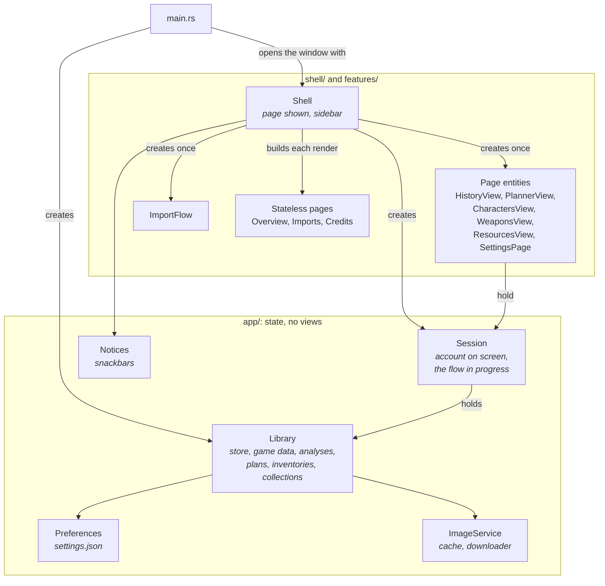
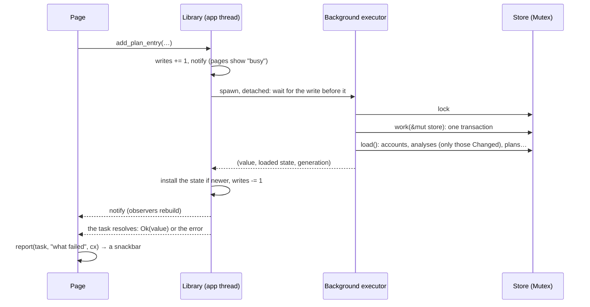
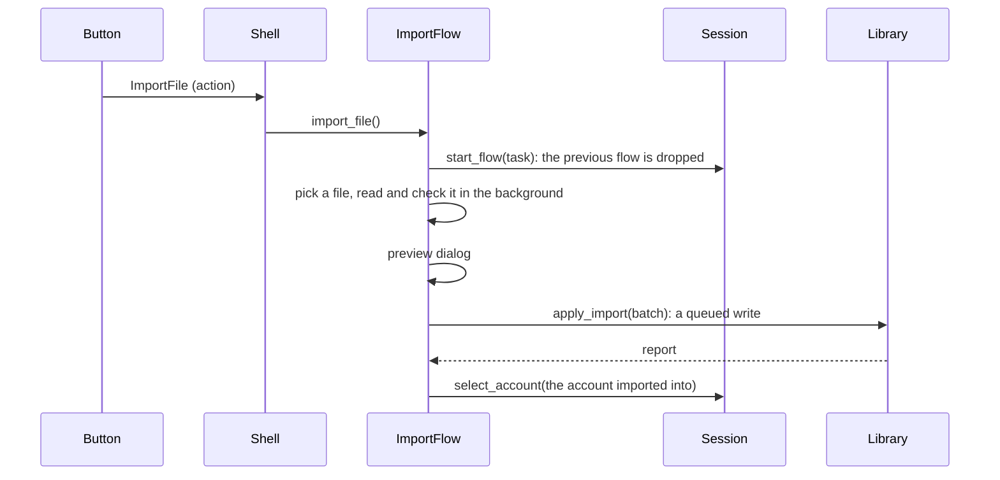

# `wish-app`: state and how it moves

The rules are at the top of `crates/wish-app/src/lib.rs` (the crate's docs): each piece of state has one owner,
others observe it and change it through its methods, one flow for the window, routing in the shell, commands as
actions. This page shows how those rules play out: who holds what, what happens on a read, a write, a flow.

## Who owns what



| State | Owner | Read it with | Change it with |
| --- | --- | --- | --- |
| Accounts, wishes and their analyses, plans, inventories, collections, imports, backups, game data | `Library` (`app/library/`) | `library.read(cx).accounts()`, `.plan(account)`, `.owned(account)`, `.planner()`, `.data()`… | its methods (`add_plan_entry`, `apply_good`, `undo_import`…), each a queued write |
| Settings | `Preferences` (`app/preferences.rs`) | `library.read(cx).settings(cx)` | `Preferences::change` and its `set_…` |
| The game's images | `ImageService` (`app/image_service.rs`) | `library.read(cx).images(cx)` | asking for an image queues it; `download_all`, `clear_cache` |
| Account on screen, flow in progress | `Session` (`app/session.rs`) | `session.read(cx).account()`, `.summary(cx)`, `.pools(cx)` | `select_account`, `start_flow` |
| Page shown, folded groups | `Shell` (`shell/`) | `shell.page()` | `navigate`, `toggle_group`, the `open_…` methods |
| A page's own state (sliders, filters, sort, open dialog) | the page's entity | the page itself | the page itself |
| App-wide commands | GPUI actions (`ImportFile`, `ImportFromGame`, `SyncFromHoyolab`, `ImportGood`, `Quit`) | n/a | dispatched by buttons and the menu, handled by the shell |

Fields are private everywhere, so the compiler holds these lines.

## Reading: observe, then read

A page never copies shared state. It holds an `Entity<Session>` (and through it the library), reads what it needs
when it renders or rebuilds its model, and observes the entity so it hears of changes:

```rust
cx.observe_in(&library, window, |this, _, window, cx| {
    this.sync_controls(window, cx);
    this.rebuild(cx); // the page's model, worked out again from the library
    cx.notify();      // and drawn again
});
```

`Library` notifies after every reload. `Session` notifies when the account changes, and passes the library's
notifications on (the account may have gone). `ImageService` notifies when an image arrives; only the shell
observes it and redraws: the library's observers (which rebuild tables and sliders) aren't woken by images.

A page that works text out ahead of a render (a model, a picker's options, the table's columns) does it again when
the library notifies, which a change of language does ([i18n.md](i18n.md)).

## Writing: the queue

Every database write goes through `Library::write` (`crates/wish-app/src/app/library/write.rs`):



What it promises, each tested in `crates/wish-app/src/app/library/tests.rs` under the test scheduler's random
order:

- **Order.** Writes run one at a time in the order they were made: each waits for the one before it, not just for
  the lock (threads take a lock in any order). `+1` clicked twice counts twice; of two quick changes to one slider
  the later stays.
- **The newest state wins.** Each load carries a generation number taken under the lock; an older load arriving
  late is not installed.
- **A write finishes.** It is detached, so dropping the returned task (a flow cancelled by another) doesn't stop
  it.
- **A failure undoes the screen.** After a failed write the state is reloaded anyway, so what a page showed at once
  (a slider, a reorder, an inventory count) goes back. Every analysis is worked out again.
- **A panic becomes an error.** The transaction rolled back as it unwound; the lock it poisoned is taken back
  (`service::lock`, the one way the app locks a mutex); the state is reloaded. This needs panics to unwind:
  never set `panic = "abort"` in a profile.
- **Quitting waits.** `on_app_quit` waits up to 5 s for the writes under way, then writes the mirror.

The reload is cheap where it matters: `Store::take_changed` says which accounts' analyses a write may have changed
(their wishes, manual counters or server), and the others are kept. Plans, inventories and collections are read
again whole.

A write's error goes to the player with `notices::report` (or `report_outcome` for a message either way); a
feature wraps it with its own words (`report_plan`, `report_characters`). Never `.detach()` a write's task
silently, and never make its report a session flow: a later flow would cancel the report.

## The mirror

When the player chose a mirror folder (Settings), every write that changes data marks the mirror due. `mirror.rs`
writes a snapshot there `MIRROR_DELAY` (3 s) after the last change, each change starting the wait again, and at
quit. It writes under the store lock, so quitting waits for a write under way. Choosing the folder writes it at
once. See [storage.md](storage.md) for the snapshot itself.

## Settings

`Preferences` changes in memory at once and saves in the background, in order: an older save never overwrites a
newer one. The library passes a change on to its own observers, since a setting can change what pages show
(counting by hand adds every banner type to the history; the language changes every text). A `settings.json` that
doesn't parse is renamed `settings.json.<UTC time>.damaged` and Settings says so.

## Flows

A flow is async work that ends in a dialog or a message: an import, an export, a restore, a fetch. There is one
for the whole window: `Session::start_flow(task)` drops, and so cancels, the previous one before it can open a
stale dialog. Writes aren't flows (the library runs them, and they always finish); a cancelled flow only loses its
next step.



## Network work

A use case that fetches (the game's history, HoYoLAB) takes `&Mutex<Store>` and locks it before and after its
requests, never during (`service::lock`). The library runs it on the background executor and passes the
`Services` it was opened with (`app/services.rs`): `Services::network()` in the app, `Services::offline()` in
tests, where every request fails, nothing downloads and there is no keyring, and fakes are put in for one flow.

The library also owns the HoYoLAB login the system keyring keeps, if the player asked (`KeptLogin`), and the
chronicle synced with it on its own (`library/kept_login.rs`, [chronicle.md](chronicle.md)): it asks the keyring
once the data is open, and checks every half hour whether a sync is due.

## Notices

`notify(Notice::done(…) | Notice::failed(…), cx)` from anywhere shows a snackbar centred under the page
(`app/notices.rs`). Done goes after 4 s (longer for a long message, 10 s at most); Failed stays until closed; three
at most, newest lowest. `Notice::failure(what, &error)` words a failure as "what: why". The shell draws them
deferred at `NOTICES_PRIORITY`, above dialogs and below popups and tooltips. Never use the kit's
`window.push_notification`: its toasts cover the pages' buttons.

## Opening the data

`Library::open(paths, services, cx)` opens the store on the background executor (migrating and backing up as
needed), loads the game data (the embedded copy or a newer one from `<data dir>/game-data/`, with a warning when a
copy is set aside) and settles in `LoadState::Ready` or `Failed`. The shell shows a spinner meanwhile, and the
reason with a "Show data folder" button on failure.
