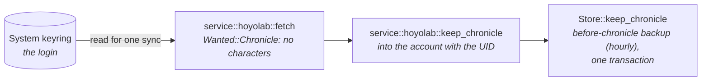

# The chronicle: what HoYoLAB forgets, kept

HoYoLAB shows the Spiral Abyss and the Imaginarium Theater of the period under way and the one before, and the
Traveler's Diary (primogems and Mora, by source and reward by reward) of this month and the two before. Then they
are gone. The chronicle keeps each period HoYoLAB showed, for good, so a sync once a month loses nothing.

```mermaid
graph LR
    hoyolab["hoyolab::chronicle<br/><i>spiralAbyss, role_combat,<br/>ysledgeros month_info and month_detail</i>"] --> fetch
    fetch["service::hoyolab::fetch<br/><i>with the characters, paced</i>"] --> records["Record<br/><i>one per period,<br/>HoYoLAB's answer whole</i>"]
    records --> preview["RecordsPlan<br/><i>to keep, to update, kept</i>"]
    preview -->|"the player confirms"| apply["Store::apply_hoyolab<br/><i>before-sync backup, one transaction<br/>with the collection</i>"]
    apply --> db[("chronicle table")]
    db --> read["Chronicle::read<br/><i>typed, newest first</i>"]
    read --> pages["Chronicle → Spiral Abyss,<br/>Imaginarium Theater, Traveler's Diary"]
```

## Where it lives

| Layer | Files |
| --- | --- |
| Requests and HoYoLAB's types | `crates/hoyolab/src/chronicle.rs` |
| The domain: records, years of Diary months, the rule of a period over | `crates/wish-core/src/chronicle.rs` |
| Fetching it with the characters | `crates/wish-core/src/service/hoyolab.rs` |
| Storage | `crates/wish-core/src/store/chronicle.rs`, `crates/wish-core/src/store/schema/010_chronicle.sql` |
| Snapshots (version 3) | `crates/wish-core/src/snapshot.rs`, `crates/wish-core/src/store/merge.rs` |
| The pages | `crates/wish-app/src/features/chronicle/` (`model.rs` pure, `abyss.rs`, `theater.rs`, `diary.rs`) |

## Kept whole

A `Record` is one period: its kind (`abyss`, `theater`, `diary`), its period (the game's number for an Abyss or
Theater period, the same for every player; the Diary's month as `YYYYMM`), when it was fetched, whether the period
was over then, and **HoYoLAB's answer as it came**. Nothing it sent is dropped, even what the pages don't show yet:
a later version can show more of what is already stored, and a field HoYoLAB adds is kept too. What the pages show
is read from it each time (`Chronicle::read`), never stored.

- The Abyss: `spiralAbyss` with `schedule_type` 1 (under way) and 2 (the one before); a period not fought isn't
  kept.
- The Theater: `role_combat` answers both periods at once; each period the player took part in is a record of its
  own.
- The Diary: `month_info` for each month HoYoLAB keeps (`optional_month`), and every page of its primogem log
  (`month_detail`, 100 rewards a page). Its data is `{"month": …, "primogems": [pages…]}`. The Mora log isn't
  fetched: hundreds of rewards a month, many requests, little to see.

HoYoLAB names a Diary month without its year: it is the latest month of that number up to the server's month under
way (`Record::diary`, in the server's time zone).

The types reading the answers (`SpiralAbyss`, `TheaterPeriod`, `DiaryMonth`…) are lenient: a field left out is its
default, a number may come as a string (HoYoLAB sends times as `"1700000000"`), and an unknown field is ignored. A
record this version can't read at all is counted (`Chronicle::unreadable`) and said on the page; it stays stored.

## A period over never changes

`chronicle::merge` decides what a period fetched again does to the one kept:

- nothing kept for it: added;
- the kept one was fetched **once the period was over** (`ended`): it stays, whatever comes later;
- the kept one was fetched while under way: a newer fetch that says something else replaces it, since it shows
  more of the period.

An Abyss or Theater period is over once its end time is past. A Diary month is over a day after it ends on the
server: HoYoLAB adds a reward to the Diary a while after it is earned. The same rule merges a snapshot's chronicle,
so importing a snapshot twice changes nothing. An account with a chronicle can't be removed, like one with wishes:
it is data nothing else holds.

## The sync

There is one HoYoLAB sync: `service::hoyolab::fetch` asks for the characters, then the chronicle, with the
library's pacing between the chronicle's requests (about ten). The preview says per kind how many periods it
keeps and updates (`RecordsPlan`), and `Store::apply_hoyolab` writes the collection and the chronicle in one
transaction, after the `before-sync` backup. The cookie is used for those requests only, as for the characters
([imports.md](imports.md)).

## Synced on its own, with the login the keyring keeps

When the player ticks "Remember this cookie on this computer" in the sync's dialog, and HoYoLAB accepts the cookie,
`Library::remember_login` keeps its login (`Cookie::login`: `ltuid_v2`, `ltoken_v2`, `ltmid_v2`, never the cookie
token) in the system keyring (`crates/wish-core/src/keyring.rs`: the Keychain, the Credential Manager or the Secret
Service, through `keyring-core` and a store per system). Without a keyring the box is off and nothing is kept, no
file instead. `settings.json` keeps what goes with it, never the login: the game UIDs behind it and when the
chronicle last synced (`HoyolabLink`).

`crates/wish-app/src/app/library/kept_login.rs` then syncs the chronicle on its own while the app is open: when it
opens, and every half hour after, once six hours have passed since the last sync.

- **No preview**, the one write of the app without one: it only adds periods or brings one under way up to date
  (a period kept once over never changes), only into accounts that already have the UID (an account HoYoLAB lists
  that none here has is left for a sync the player confirms, which links one), and never the characters.
- **A backup first** when something changes, at most one an hour (`before-chronicle`, kept apart with the hourly
  ones so it never pushes the backups of real imports out). Nothing changes: no write, no backup.
- **What is said**: a notice when periods were kept or brought up to date; nothing when there was nothing new.
- **HoYoLAB refuses the login** ("not logged in"): it is forgotten, and a notice asks for a new sync. **A captcha**:
  the syncs on their own stop until the app opens again, and a notice says so. No network, HoYoLAB busy: the next
  check tries again, without a word.
- **Forgotten** on the player's request (Settings → HoYoLAB, which also syncs now), when HoYoLAB refuses it, and when
  the last account with one of its UIDs is removed.

The keyring encrypts the login at rest; it doesn't keep it from a program running as the player. Tests and the
screenshot tool never reach the player's keyring: `Services::offline()` has none, and `MemoryKeyring` stands in.

## The pages

Chronicle in the sidebar, three pages (`Page::Chronicle(ChroniclePage::…)`), one entity, `ChronicleView`, which
keeps the period picked on each. A page shows the period picked, a chart of one figure over every period kept
(stars, the furthest act, primogems per month), and its detail: the Abyss's records and each floor's teams; the
Theater's highlights and each act's cast (trial and support characters marked); the Diary's sources, its
primogems per day and every reward. Characters are matched to the game data by id
(`collection::hoyolab_character`; the Traveler by element); one the data lacks shows as an empty tile with its
id. HoYoLAB names the Diary's sources in English; the usual ones are translated, the others shown as sent.

## Testing

`crates/hoyolab/src/chronicle.rs` and `crates/wish-core/src/chronicle.rs` test the reading and the rules;
`crates/wish-core/tests/chronicle.rs` a sync through a fake HoYoLAB, a period brought up to date then frozen, and a
snapshot's round trip; `crates/wish-core/tests/formats.rs` the version 3 witness. `wishctl hoyolab-check` asks the
real HoYoLAB with the player's cookie (in their own terminal) and says whether each answer reads.
