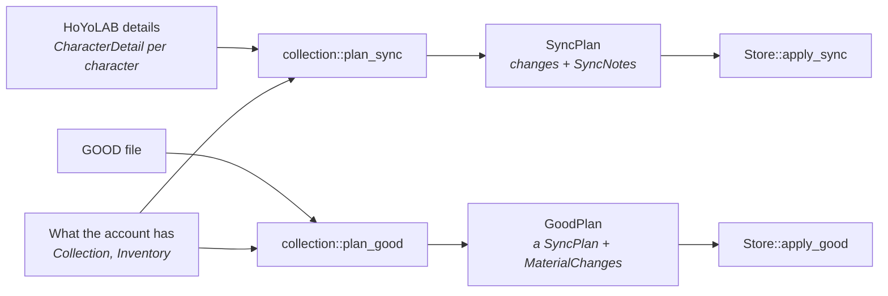

# The collection and the archive

## What an account owns

`crates/wish-core/src/collection/` is what an account owns, as the player entered it or a sync brought it:

- `OwnedCharacter`: key, level and phase, constellation 0–6, the three talents 1–10 (without the constellations'
  bonus), favourite.
- `OwnedWeapon`: **one per copy**, with level and phase, refinement 1–5, the character holding it (a character holds
  one copy at most: giving it another takes it from the first), favourite.
- `Collection` holds both; `Collection::character_goal` and `weapon_goal` say where planning starts (the owned
  level and talents; a weapon's most levelled copy that can still go up, else level 1).
- `collection/stats.rs` works out the Overview's figures: `CharacterStats` (owned of the game's characters, the
  Traveler once per element; by rarity, element, weapon, constellation) and `OwnedWeaponStats` (by rarity and type,
  copies, refinements, holders). `ELEMENTS` and `WEAPON_TYPES` are in the game's order.

Stored in `owned_characters` and `owned_weapons` (`crates/wish-core/src/store/collection.rs`): each write is one
transaction after at most one hourly `before-planning` backup, like the plan's. A snapshot carries the collection,
and importing one only adds or raises ([storage.md](storage.md)).

In the app: `Library`'s `collection.rs` writes, and the pages are Archive → Characters ("My character"), Archive →
Weapons ("My copies") and the Overview's Characters and Weapons tabs.

## Syncs: HoYoLAB and GOOD

Both turn what a source says into a plan of changes against what is stored, shown before anything is written.
**Neither ever lowers anything**: each character and weapon copy is `Added`, `Raised` or `Unchanged`.

### A HoYoLAB sync (`collection/sync.rs`)

- Characters match by game id; the Traveler (10000005 or 10000007) by element. Talents match by their names in
  `archive.json` (English: `Text::english`), less the +3 an active C3 or C5 gives.
- Level caps whose phase HoYoLAB doesn't send are counted as not ascended (and said); levels above 90 count as
  90/90 (said); characters, weapons or talents the data lacks are left out (listed). Each note is a `SyncNote`,
  whose `Display` the preview and `wishctl` print.
- A weapon copy is the one its holder has; else one without a holder; else one a character of the sync let go of
  (it holds another weapon in the game: a swap moves the copies rather than adding two); else a new copy.
- `Store::apply_sync(target, game, …)` gives the chosen account the UID and the server (or makes the new one),
  works the plan out again against the stored collection, and writes it in one transaction after a `before-sync`
  backup.

### A GOOD file (`collection/good.rs`)

- Keys are the English names run together (`good_key`: apostrophes dropped, accents off, other symbols word
  breaks, each word capitalised), matched against `planner.json`'s names. A weapon's holder `Traveler` is the
  file's Traveler.
- Characters come with their ascension phase, talents without the constellations' boost, above 90 as 90/90 (said);
  raised as a sync raises them (`sync::character_change`).
- **Every weapon copy**, fodder included: the one its holder holds; else a stored copy alike; else the most levelled
  one below it (raised); else a new copy. Held copies first, then from the most levelled down. A copy whose holder
  holds that weapon in the file too is left to that holder.
- **The bag is whole**: the planner's materials take the file's counts, and one the file lacks goes to 0. Mora
  apart: the files carry none (`SyncNote::NoMora`). A file without materials leaves the inventory as it is
  (`NoMaterials`). Entries that aren't planner materials (food, gadgets) are counted, not imported
  (`OtherItems`).
- `Store::apply_good(target, file, planner)` (`None`: a new "Main") works it out again against what is stored and
  writes it in one transaction after a `before-sync` backup.

Checked on a real Irminsul export (113 characters, 1,940 copies, 1,349 entries). Real GOOD exports for the tests go
in `crates/wish-core/tests/fixtures/private/good/` (git-ignored).

The dialogs are `crates/wish-app/src/features/imports/hoyolab/` and `good/`; their preview's words are each one's
`model.rs`, tested alone. A weapon that only changes hands shows as moved (⇄); identical lines show once with their
count (a GOOD file's fodder comes by the hundred).

## The archive

`ArchiveData` (`crates/wish-core/src/archive.rs`) reads the embedded `archive.json`, keyed like the planner:

- `CharacterPage`: the profile (title, region, affiliation, birthday, constellation's name, version), `BaseStats`,
  talents with their values at levels 1–15, constellations, the art and icon names. `ArchiveData::stats` gives the
  stats at a level: base × the growth curve at that level, plus the ascension phase's bonus.
- `Talent::values(level)` formats each row as the game does (`P` a percentage, `F1P` one decimal and a
  percentage, `F1`…).
- `WeaponPage`: description, version, wish art name, `WeaponStats` (ATK and the secondary stat with their curves,
  the phases' ATK bonus), and its passive at refinements 1–5 (one text for unrefinable weapons).
  `ArchiveData::weapon_stats` works them out at a level.

Every name and text there is a `Text` in every language the data has ([i18n.md](i18n.md)).

The pages (`crates/wish-app/src/features/archive/`) are three entities with the same shape ([pages.md](pages.md)):

| Page | What it shows |
| --- | --- |
| Characters | the account's characters first (level and constellation, ☆, ×), the others faded with +; filters (element, weapon, rarity, owned, favourites), sort and its direction; a character's page: the hero banner (the art over its blurred backdrop), "My character", stats at the slider's level and what reaching it costs, ascension, talents at the talent slider with their cost, constellations; "Add to the planner" |
| Weapons | the same for weapons, a card showing the best refinement and the copies ("R3 · ×2"); a weapon's page with "My copies" (one row per group of copies alike: same level, refinement, holder and favourite), stats at the level slider, the passive at the refinement; each copies row edits its first copy (level over `Level::weapon_steps`, refinement, "Held by" among the owned characters of that weapon type, favourite, "Remove one" after asking), its pickers (`CopyControls`) kept in step with the stored copies (`sync_copies`) |
| Resources (the user's ask on 2026-11-17) | every material of the game data (placeholders apart) in sections as the game's bag sorts them, with the account's count; a search and "Owned only"; a click opens the planner's inventory dialog |

Resources tells boss from weekly boss materials, and common from elite drops, by the planner's roles
(`PlannerData::families`), since the game files each pair under one kind. A kind it doesn't know goes to "Other",
which a test keeps empty.

Shared by the three: `filters.rs` (the filter bar, after genshinlist.vercel.app's: a search, "Filter" opening the
app's own drawer, "Sort by", the direction button, chips for the filters on) and `shared.rs` (`item_card`, the list
card of all three pages; the hero banner, facts, level badge, stats table).
