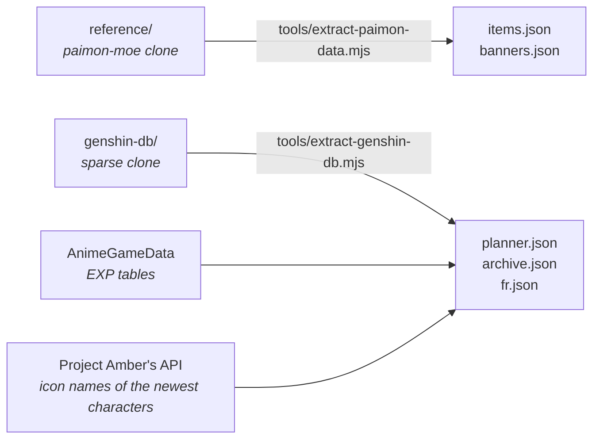

# The game's data

The app carries the game's names, numbers and texts, embedded in the binary so everything works offline:
`crates/wish-core/data/`. They are short, and they are what the wikis and genshin-db publish; the player chose to
keep them (the review's LEG-2, option 1). **The game's images are not embedded**: see [images.md](images.md).

| File | What it holds | Read by | Written by |
| --- | --- | --- | --- |
| `items.json` | every character and weapon a wish can give: key, English name, rarity, HoYoverse's id | `data.rs` (`GameData`) | `tools/extract-paimon-data.mjs` from `reference/` |
| `banners.json` | every banner per type: times, featured items, time-zone flags, side-by-side banners | `data.rs` (`GameData`) | same |
| `planner.json` | characters, weapons and materials with their costs, domains and days, the EXP tables | `planner/data.rs` (`PlannerData`) | `tools/extract-genshin-db.mjs` from `genshin-db/` |
| `archive.json` | character and weapon pages: profiles, stats and growth curves, talents and their values, constellations, passives, art and icon names | `archive.rs` (`ArchiveData`) | same |
| `fr.json` | the same names and texts in French, by key (materials by id), and every character's and weapon's name by its English one | `i18n/game.rs` | same |

## Where it comes from



- `node tools/extract-paimon-data.mjs` regenerates the wish data after `git -C reference pull`. It fails on an
  unknown featured key; a real typo goes in `KEY_FIXES` in the script.
- `node tools/extract-genshin-db.mjs` regenerates the planner's, the archive's and the translations after
  `git -C genshin-db pull`. It fails on a cost naming an unknown material. Characters without talent data (the
  Manekins) are skipped and listed. Talent rows in another language are kept only with the English rows'
  parameters, so the values are the same. `LANGUAGES` in the script lists the languages.
- `genshin-db/` is a sparse clone of https://github.com/theBowja/genshin-db; `reference/` a clone of paimon-moe.
  Both are git-ignored and read-only: never edit them. To make the sparse clone:

  ```bash
  git clone --depth 1 --filter=blob:none --sparse https://github.com/theBowja/genshin-db
  git -C genshin-db sparse-checkout set src/data/English/characters src/data/English/talents \
    src/data/English/weapons src/data/English/materials src/data/English/constellations \
    src/data/French/characters src/data/French/talents src/data/French/weapons src/data/French/materials \
    src/data/French/constellations src/data/image src/data/stats src/data/curve src/data/version
  ```

Commit the JSON the scripts write. The app reads only these files, its own format, so a change of source only
changes a script.

## Newer data without a new build

A copy of any of these files in `<data dir>/game-data/` takes precedence, so a new banner doesn't need a rebuild.
`GameData::load` never fails: a copy that can't be read, or that is older than the embedded one (an item missing,
banners ending earlier), is left out with a warning (Settings and the archive show it), and the embedded one is used
so the wishes always open. `PlannerData::load` and `ArchiveData::load` read their copies the same way. These
`std::fs` reads are the known crossings `crates/wish-core/tests/layers.rs` lists.

## What the data must hold

`GameData::from_json` checks every banner's featured items name a known item: a wrong one would make every 50/50
after it wrong. The embedded copies are checked by the extraction scripts and the tests (`tests/planner.rs` checks
totals the game is known for: [planner.md](planner.md)).
