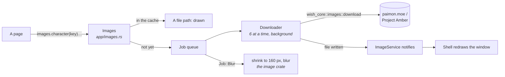

# The game's images

**The game's images are never in the repository or the builds.** They are HoYoverse's, and the player chose not to
redistribute them. The app downloads each one the first time a page shows it, from the fan sites that already serve
them, and keeps it in `<data dir>/cache/images`. Never add game images to the repository, or a tool that packs
them; screenshots of the app (the README's) are fine.

| Images | Source | Cache file |
| --- | --- | --- |
| wish icons, banner art, the primogem | paimon.moe's site | `paimon/…` |
| character, weapon, material, element, talent and constellation icons, wish art, Original Resin | Project Amber (`gi.yatta.moe/assets/UI/<game file>.png`) | `amber/…` |
| blurred backdrops of wish art | made here | `blur/<file>` |

## The parts

- `crates/wish-core/src/images.rs`: `Remote` names each image's cache file and its URLs (`Remote::wish_icon`,
  `banner`, `amber`, `skill`, `element`…); `download` fetches one with a few checks (only images, 16 MB at most,
  never outside the cache (`in_cache`), https only, no redirect; paimon.moe answers a missing file with its HTML
  page, which counts as missing); `catalog` lists every image of a `Collection` for "download all". No GPUI.
- `crates/wish-app/src/app/images.rs`: `Images`, the images by what they show (`item`, `banner`, `character`,
  `material`, `skill`, `splash`, `backdrop`…). It answers from the files it knows are in the cache and queues the
  others; asking never blocks. Until an image is there, or offline, the page draws its place empty: everything
  works without images.
- `crates/wish-app/src/app/image_service.rs`: `ImageService`, an entity of its own so an image arriving redraws the
  window without waking the library's observers. "Download every image" for offline use
  (`download_all(Collection::Icons | Everything)`, with progress and Stop) lives here; `Images::claim` keeps it and
  the pages from fetching one file twice.

A failed download is retried at the next launch. One the sites don't have (404) leaves a `<file>.missing` marker,
trusted for a week (`images::MISSING_FOR`).

Downloads are opt-in beyond what pages show: don't add eager prefetching, it would load two volunteer-run sites.
Tests open the library with `Services::offline()`, where nothing downloads; the screenshot tool downloads what each
page needs and waits for it before each capture.

Banner files are named by `Banner::slug()`, never by the raw name: a `:` would make GPUI take the path for a URL.
