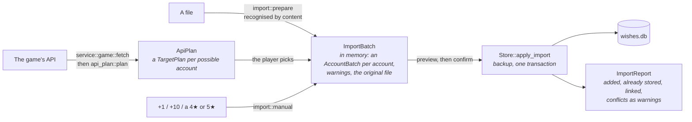
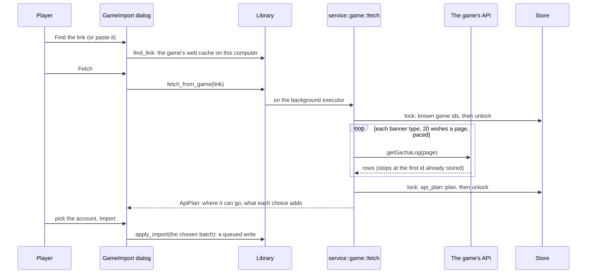
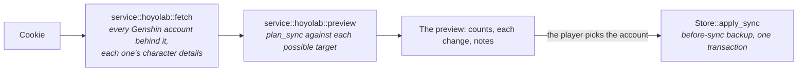

# Imports: every way data comes in

Every source follows the same shape: **read and check in memory, show what would change, write only once the
player confirms**, in one transaction after a backup. Nothing is guessed: an unknown item or an unreadable time
fails the import with a clear message, since a wrong rarity would corrupt every pity count after it.

| Source | Reads | Plans against the store | Writes | Where in the app |
| --- | --- | --- | --- | --- |
| paimon.moe save (JSON) | `import/paimon.rs` | no (and `paimon_check.rs` compares the numbers) | `Store::apply_import` | Import → From a file |
| paimon.moe spreadsheet | `excel.rs` | no; an account without a UID goes to the one on screen | `apply_import` | same |
| UIGF v4 | `uigf.rs` | yes, like a game import (`api_plan`) | `apply_import` | same |
| Snapshot (this app's) | `snapshot.rs` | no; its collection, plan and inventory are merged | `apply_import` + `store/merge.rs` | same |
| The game's history | `import/api.rs` (+ `game_cache.rs` to find the link) | yes: `import/api_plan.rs` | `apply_import` | Import → From the game |
| Counting by hand | `import/manual.rs` | no | `apply_import` (`ImportSource::Manual`) | history page, when Settings turns it on |
| HoYoLAB (characters, weapons) | `hoyolab` crate → `collection/sync.rs` | yes: `plan_sync` | `Store::apply_sync` | Import → HoYoLAB |
| GOOD file (characters, weapons, materials) | `collection/good.rs` | yes: `plan_good` | `Store::apply_good` | Import → GOOD |

Paths are under `crates/wish-core/src/`.

## Wishes: from a source to the database

`import::prepare` (`crates/wish-core/src/import/mod.rs`) recognises a file by its content, not its name: an
`.xlsx`, a UIGF file, a snapshot (a file that says it is one is read as one, so a damaged or newer snapshot says
so), else a paimon.moe save. The result is a `PreparedImport`: the batch, and for a paimon.moe save the comparison
of this app's numbers with the ones paimon.moe stored.

`Store::apply_import` (`crates/wish-core/src/store/import.rs`), for each account of the batch:

1. **Finds the account** (`resolve_account`): the one the player chose (`merge_into`), else the one with the UID,
   else one with the same name and no UID yet (which takes the UID), else a new one. An account's missing server
   is filled in; nothing else of an existing account changes.
2. **Logs the import** in `imports`, and every row it adds carries that `import_id`.
3. **Adds the wishes** with `INSERT … ON CONFLICT (account_id, id) DO NOTHING`: a wish whose id is stored stays as
   it is; one whose content differs is reported, never rewritten. Never `INSERT OR IGNORE`, which also skips rows
   that fail a `CHECK` without a word. A wish migrated from paimon.moe that the game's record already holds (same
   pool, time and item, counted as a multiset since a 10-pull can hold the same 3★ twice) is counted as already
   stored.
4. **Adds manual counters** and **game ids** (`wish_links`) the same way: what is stored stays; a disagreement is a
   warning.
5. **Merges a snapshot's extras** (collection, plan, inventory): only adds or raises.

A backup comes first (`before-import`; for counting by hand, at most one `before-counting` an hour), and the
imported file is kept under `imports/` (the same file twice reuses its copy).

## The game's history

- **The link** carries a temporary `authkey` that authorises the JSON API behind the in-game history page.
  `import/game_cache.rs` finds the most recent one in the game's web cache (Windows, and Wine prefixes on Linux);
  the player can also paste one. `GachaLink::parse` checks it.
- **Fetching** (`import/api.rs`) asks with `lang=en-us` so names match the item data. The rarity comes from the
  answer's `rank_type`, so a character or weapon the data doesn't know yet never fails the import (a file
  without rarities, a paimon.moe save, does fail on one). It fetches 20 wishes a page, newest
  first, and stops at the first wish already stored. A page shorter than 20 is the last. The retcodes: 0 ok, −101
  the link expired, −100 the link is cut or altered, −110 too frequent (retried with backoff). `Pacing` spaces the
  requests (at once in tests). The store is never locked during a request.
- **Planning** (`import/api_plan.rs`) puts each fetched wish in one of three places: already known (its id is
  stored or linked) → skipped; newer than everything stored → new; otherwise it should already be there as a
  migrated paimon.moe wish at the same time with the same name → its game id is recorded as a link. If not, it is a
  gap in the migrated history and is added, unless the pool holds wishes typed by hand in paimon.moe (their times
  are made up, so the game's record of the same wish wouldn't match and would count twice): then it is held back
  and reported.
- **Where it goes**: the account with that UID; without one, a new account first, then each account without a
  UID. The dialog suggests one and the player can pick another.

API tests use `api::tests::FakeApi`; tests never call the real API. `wishctl fetch-game <link>` shows what an
import would add without writing anything.

## Counting by hand

When Settings turns it on, each history page gets `+1`, `+10` and "Add a 4★ or 5★…" (`import/manual.rs`): each
entry is a small `ImportSource::Manual` import, so it shows in Recent imports and undoes like any other. Wishes
counted by hand can also be deleted (`Store::delete_manual_wishes`, after a backup); wishes from any other source
can't: undo their import instead.

## HoYoLAB

The `hoyolab` crate (`crates/hoyolab/`) asks HoYoLAB for the game accounts behind a cookie, their characters as
the Battle Chronicle shows them, and an authkey. It follows genshin.py's endpoints and request signature (no code
taken; its MIT notice is in Credits). It knows nothing of the app, and has its own `LICENSE` and genshin.py's
notice, so it can be published alone. Retcodes become errors the player can act on (`error.rs`: not logged in,
data not public, a captcha, too frequent).

**The cookie is the player's and is never stored.** `Cookie` keeps only HoYoLAB's fields, each a `Secret` (wiped
when dropped, hidden from `Debug` and `Display`); `HttpTransport` sends it over https to HoYoverse's hosts only,
with no redirect followed; no error message holds it. In the app, the dialog's three masked fields (`ltuid_v2`,
`ltoken_v2`, `ltmid_v2`, which the player copies from the browser's Storage tab), or a whole cookie read from the
clipboard (then cleared), are emptied when the fetch starts, and the cookie is
dropped when its requests end. `wishctl`'s HoYoLAB commands read it from stdin with the terminal's echo off.

What a sync changes, and its rules (never lowers anything, how weapon copies are matched), is in
[collection-archive.md](collection-archive.md). `Store::sync_targets` lists where a sync can go, as the game import
does: the account with that UID; without one, a new account, then each account without a UID. The chosen account
takes the UID and the server.

The sync's button is on the Import page, in Archive → Characters and in the Overview's Characters tab
(`hoyolab_sync_button`), and in the app menu.

## GOOD files

GOOD is the format Irminsul, Inventory Kamera and Genshin Optimizer export. `GoodFile::parse`
(`crates/wish-core/src/collection/good.rs`) reads one (anything else is `Error::NotGoodFile`; the version isn't
checked, each version only added fields); `plan_good` works out the characters, every weapon copy (fodder
included) and the materials against what the account has; `Store::apply_good` writes it after a `before-sync`
backup. Into the account on screen, or a new "Main" when there is none. The rules are in
[collection-archive.md](collection-archive.md).

## Undo

Every import except a HoYoLAB sync and a GOOD import is in the log (Settings → Recent imports) and can be undone:
`Store::undo_import` takes a backup, removes exactly the rows carrying its `import_id`, and marks it undone. A sync
or a GOOD import is undone by restoring its `before-sync` backup. See [storage.md](storage.md).

## Accounts

Imports make their accounts on their own (named "Main", "Account 3"… after the source; these names stay English,
since imports find accounts again by them). The player can also add, identify, rename and remove accounts in
Settings → Accounts (`crates/wish-core/src/store/accounts.rs`):

- a UID says its server (`Server::from_uid`, from its leading digits) and wins over a server given;
- a UID, once an account has one, stays: the game import and HoYoLAB find the account by it;
- an account with wishes, counters or imports can't be removed (the history is what the app keeps, and undo needs
  its account); one without goes with its collection, plan and inventory, after a backup.
