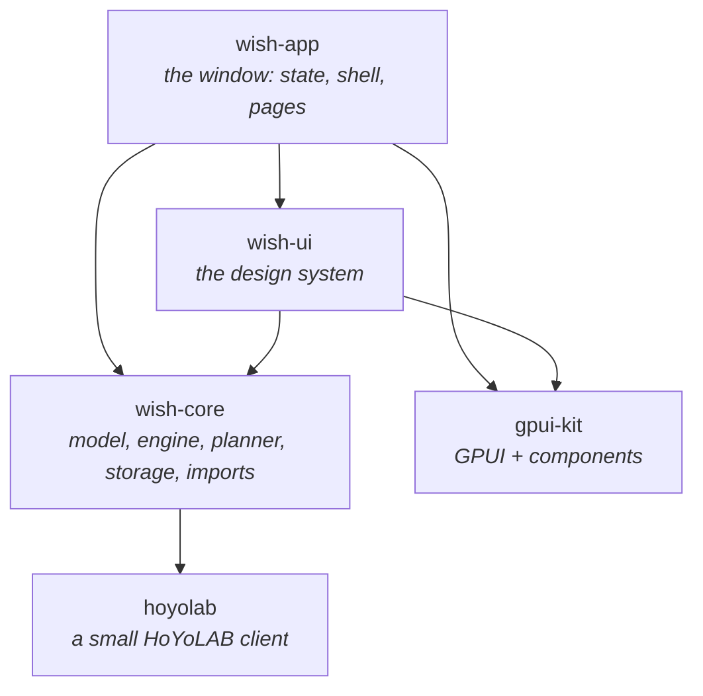
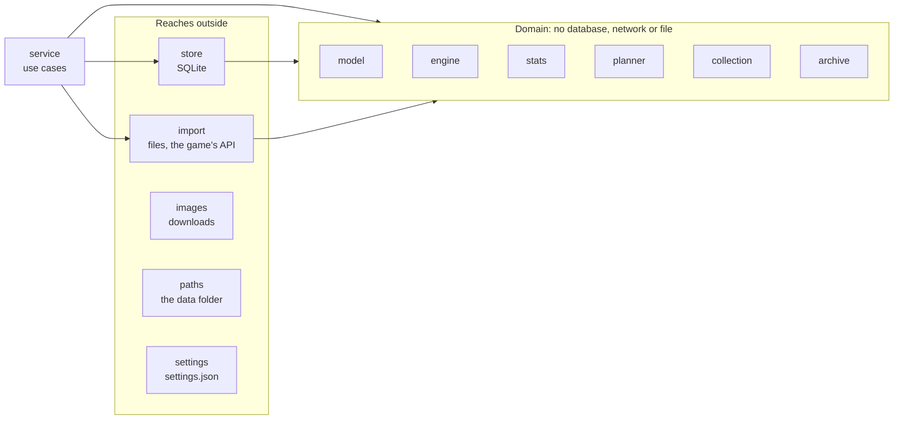

# Overview

Genshin Companion is a desktop app for Genshin Impact players, in Rust with [GPUI](https://www.gpui.rs) through
GPUI Kit. It began as a rewrite of paimon.moe's wish counter, whose browser storage loses data, and now also has a
character, weapon and material archive and an ascension planner. **The point of the project is that the player's
data, the wish history first, is never lost**: every rule in [storage.md](storage.md) follows from it.

## The crates



Dependencies only go down, and Cargo enforces it: a crate can't name one above it. It mirrors a front end's
core / shared / features split.

| Crate | Folder | What it is | Never |
| --- | --- | --- | --- |
| `hoyolab` | `crates/hoyolab` | HoYoLAB's requests (game accounts, characters, the wish history's authkey), the request signature, its error codes | knows the app; stores the cookie |
| `wish-core` | `crates/wish-core` | Everything but the window: the domain, the game data, SQLite, imports and exports, the use cases the app and `wishctl` share | depends on GPUI |
| `wish-ui` | `crates/wish-ui` | The theme, the typeface, icons, formatting, and the components every page uses; they take plain data | reads app state |
| `wish-app` | `crates/wish-app` | The window: the state entities, the shell (sidebar, routing), one folder per feature | holds domain logic: that goes to `wish-core` |

The crates keep their `wish-*` names from when the app was called Genshin Wishes; the binary, the window and the
data folder are `genshin-companion`.

## Inside `wish-core`: the domain and what reaches outside



The domain modules hold the game's rules and test alone. `crates/wish-core/tests/layers.rs` reads their sources
and fails on an import of `rusqlite`, `crate::store`, `ureq`, `std::fs`… so the line is checked, not hoped for. A
few known crossings are listed in that test with what will remove them; a crossing that disappears fails the test
too, so the list stays true.

`service/` holds the use cases both the app and `wishctl` run (fetch the game's history and plan its import,
preview a HoYoLAB sync, read a GOOD file, build an export). Each takes what it reaches (transport, store, game
data) as parameters, so tests give fakes.

## Where things are

```text
crates/
  hoyolab/src/            client.rs (requests), cookie.rs, secret.rs, ds.rs (signature), transport.rs, error.rs
  wish-core/
    data/                 embedded game data: items.json, banners.json, planner.json, archive.json, fr.json
    locales/{en,fr}/      core.ftl: the core's texts (errors, notes, names of banner types…)
    src/
      model.rs            wishes, pools, gacha types, servers, accounts
      engine.rs stats.rs  pity, banners, 50/50; the summary numbers
      data.rs             items and banners (paimon.moe's data)
      archive.rs          character and weapon pages
      planner/            costs, plan, inventory, allocation, custom entries, resin, farming
      collection/         owned characters and weapons, HoYoLAB syncs, GOOD files, the overview's figures
      store/              SQLite: accounts, wishes, imports, plan, inventory, collection, backups; schema/ migrations
      import/             paimon.moe saves, the game's API, the game's cache, counting by hand, the paimon check
      snapshot.rs uigf.rs excel.rs   the export formats (and their import)
      service/            use cases shared by the app and wishctl
      i18n/               Fluent texts, numbers, the game's texts in every language, the checks
      images.rs paths.rs settings.rs error.rs
    examples/wishctl/     the command-line tool
    tests/                engine, import, planner, collection, formats, layers, undo… and fixtures/
  wish-ui/
    src/theme.json        every raw colour, both themes
    src/                  theme.rs, components/, format.rs, axis.rs, assets.rs
    examples/gallery.rs   every component, offscreen, light and dark
  wish-app/
    locales/{en,fr}/      one .ftl per feature
    src/
      lib.rs main.rs      the data flow's rules; the binary
      app/                state and services: library/, session.rs, preferences.rs, image_service.rs, images.rs, notices.rs
      shell/              the window: routing, sidebar, dialogs opened from outside a page
      features/           overview, wishes, archive, planner, imports, settings, credits
    tests/shell.rs        the window model, headless
    examples/screenshot.rs   every page, offscreen, to PNG
tools/                    extraction scripts, the sample save, release packaging, the licences file
docs/                     architecture/ (these pages), releases/ (release notes), screenshots/ (README's)
```

`reference/` (a clone of paimon.moe) and `genshin-db/` (a sparse clone of genshin-db) are git-ignored, read-only
sources for the extraction scripts and for porting. Never edit them.

## One feature across the crates

A feature has a piece in each layer. Following one is the quickest way into the code:

| Feature | Domain (`wish-core`) | Storage | App state (`wish-app/src/app`) | Pages (`wish-app/src/features`) |
| --- | --- | --- | --- | --- |
| Wish history | `model.rs`, `engine.rs`, `stats.rs`, `data.rs` | `store/wishes.rs`, `store/import.rs` | `library/mod.rs` (analyses), `library/data.rs` (imports) | `wishes/history/`, `overview/wishes/` |
| Imports | `import/`, `snapshot.rs`, `uigf.rs`, `excel.rs`, `service/` | `store/import.rs` (apply, undo) | `library/data.rs` | `wishes/import/`, `imports/`, `settings/imports.rs` |
| Planner | `planner/` | `store/plan.rs`, `store/inventory.rs` | `library/plan.rs` | `planner/` |
| Collection | `collection/` | `store/collection.rs`, `store/merge.rs` | `library/collection.rs` | `archive/characters/collection.rs`, `archive/weapons/copies.rs`, `overview/` |
| Archive | `archive.rs`, `planner/data.rs` | none (game data only) | `library/mod.rs` (accessors) | `archive/` |
| Accounts | `model.rs` (`Account`, `Server`) | `store/accounts.rs` | `library/data.rs`, `session.rs` | `settings/accounts.rs`, `shell/sidebar.rs` |

## Entry points

| Program | Where | What for |
| --- | --- | --- |
| `genshin-companion` | `crates/wish-app/src/main.rs` | the app |
| `wishctl` | `crates/wish-core/examples/wishctl/` | a data folder from the terminal: imports, exports, summary, checks ([testing.md](testing.md)) |
| `screenshot` | `crates/wish-app/examples/screenshot.rs` | every page offscreen to PNG, to review the UI without a desktop |
| `gallery` | `crates/wish-ui/examples/gallery.rs` | every component offscreen, light and dark |
