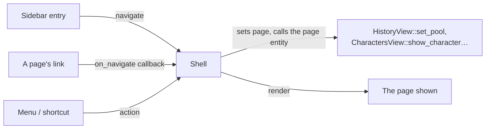
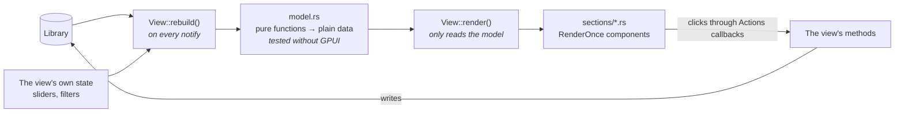

# `wish-app`: the shell and the pages

## The shell

`Shell` (`crates/wish-app/src/shell/`) is the window: the sidebar beside the page shown. It holds no page logic.

| File | What it does |
| --- | --- |
| `crates/wish-app/src/shell/mod.rs` | `Shell`: creates the session and every stateful page once, the actions, the render (loading, failure, the page), the notices layer |
| `crates/wish-app/src/shell/page.rs` | where the window can go: `Page`, `Feature`, `OverviewTab`, `WishPage`, `ArchivePage` |
| `crates/wish-app/src/shell/navigation.rs` | `navigate`, `open_overview`, `open_or_fold`, opening a character or weapon page; keeps the account picker and the page in step with the data |
| `crates/wish-app/src/shell/dialogs.rs` | dialogs opened from outside their page: the menu's commands, the screenshot tool, one page asking another |
| `crates/wish-app/src/shell/sidebar.rs` | the sidebar: the app's name, the account picker, the Overview, one folding group per feature, Import, Settings, Credits |

### Routing

Two levels: `Page::Overview(OverviewTab)`, `Page::Wishes(WishPage::History(Pool))`,
`Page::Archive(ArchivePage::…)`, `Page::Planner`, then the app's own `Page::Imports`, `Page::Settings`,
`Page::Credits`. A feature is a `Feature` with its `home()` page and a `NavGroup` in the sidebar; clicking its
header opens it, or folds its group when one of its pages is shown.

`navigate` keeps the page valid: a banner type the account has no wishes in becomes its first one with wishes, or
the Overview. The Overview's entry reopens the tab shown last.

### Pages don't know each other

A page asks the shell instead of switching itself: the Overview gets an `on_navigate` callback, Archive →
Resources an `EditMaterial` callback that opens the planner's inventory dialog through `Shell::open_inventory`. A
page that needs another page's dialog goes through the shell the same way.

The screenshot tool and the headless tests drive the window with the same `Shell::open_…` methods
(`open_custom_entry`, `open_planner_add`, `open_hoyolab_preview`, `open_good_preview`, `open_account`…), so each
dialog can be shot without clicks.

## The shape of a page

| Kind | When | Examples |
| --- | --- | --- |
| `RenderOnce` component with props | no state of its own; built by the shell on each render from the library and the session | `Overview`, `Imports`, `Credits` |
| Entity created once by the shell | state that must survive a render: a table, sliders, filters, a running task, dialogs that call back | `HistoryView`, `PlannerView`, `CharactersView`, `WeaponsView`, `ResourcesView`, `SettingsPage` |
| Entity with no view | a service several pages and the menu start | `ImportFlow` |

A big page splits as the planner does:

- The **entity** (`mod.rs`) holds the page's own state and its actions.
- **`model.rs`** works out everything the page shows as plain data: names, numbers, tiles, tooltips, pictures
  named by key or id. Pure functions, tested alone. Worked out again when the library, the account or the page's
  state changes, never in `render`.
- **`sections/`** draw the model. Each is a `RenderOnce` with props; clicks go back through callbacks (the
  planner's `Actions`), and none reads or writes the library.
- Never read the view's own entity inside its render (it is being updated): pass the view, or a weak handle.

## The features

| Folder | Pages | The files |
| --- | --- | --- |
| `crates/wish-app/src/features/overview` | the app's home: the account in figures, a tab each | `mod.rs` (frame, empty states, grids), `wishes/` (totals, a card per banner type, the monthly chart, pity), `characters.rs`, `weapons.rs` |
| `crates/wish-app/src/features/wishes` | the wish history of each banner type | `history/` (`mod.rs` the view, `model.rs` rows and cells, `table.rs`, `charts.rs`, `banners.rs`, `manual_counting.rs`), `import/` (`ImportFlow`, the game import dialog) |
| `crates/wish-app/src/features/archive` | Characters, Weapons, Resources | `characters/`, `weapons/`, `resources/` (each a view, a model, a list, a page), `filters.rs` (the filter bar and its drawer), `shared.rs` (the list card, the hero banner, stats) |
| `crates/wish-app/src/features/planner` | the ascension planner | `mod.rs` (the view), `controls.rs` (sliders), `model.rs`, `sections/` (`still_needed`, `card`, `materials`, `drag`), dialogs: `add.rs`, `custom.rs`, `inventory.rs`, `resin.rs` |
| `crates/wish-app/src/features/imports` | the Import page | `mod.rs` (a card per source), `hoyolab/` (the sync dialog: form, fetch, preview, model), `good/` (the GOOD import dialog and its model) |
| `crates/wish-app/src/features/settings` | Settings | `mod.rs` (layout, rows), `accounts.rs`, `data.rs`, `backups.rs`, `mirror.rs`, `imports.rs`, `export.rs`, `images.rs` |
| `crates/wish-app/src/features/credits` | Credits | the notices the licences require, and the open-source licences dialog |

More on each feature's logic: [wishes.md](wishes.md), [planner.md](planner.md),
[collection-archive.md](collection-archive.md), [imports.md](imports.md).

## Layout

- `PageFrame` (from `wish-ui`) is every page's frame: the title, actions, a toolbar, the body. `.max_width` centres
  title and body in a column (Settings, Import, Credits).
- `shell::content_width(window)` is a page's content width (the window less the sidebar and the page padding), for
  layouts that size from it: the planner's columns, the settings' two columns, the character hero.
- Dialogs open with the kit's `window.open_dialog`; widths come from `window.rem_size()`. Alert dialogs take
  `.footer(dialog_footer(button(…).danger()…))`.
- The archive's filter drawer is the app's own (`filter_drawer`), deferred over the page: the kit's `Sheet` has no
  exit animation.

Components and the look are in [ui.md](ui.md); GPUI's habits and pitfalls in [gpui.md](gpui.md).
