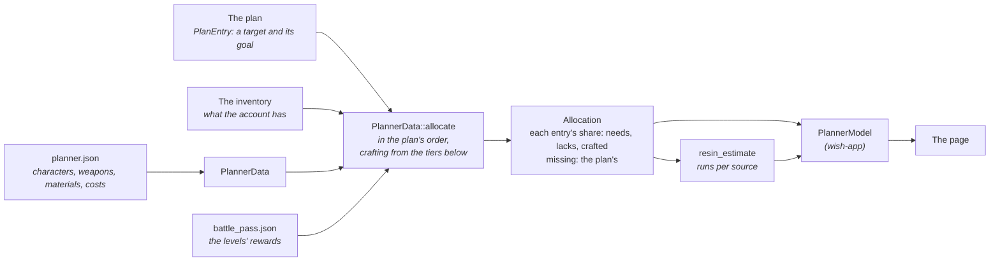

# The ascension planner

After genshin-center's: the characters and weapons the player wants to raise, each from where it is to where it
should go; what that costs in materials; what the player's bag covers when it is shared out over the plan in
order (with the Battle Pass's rewards still to come, when they count); what is still lacking, and the resin it
takes.

The rules live in `crates/wish-core/src/planner/`; the page in `crates/wish-app/src/features/planner/`.

## The game data

`PlannerData` (`planner/data.rs`) reads the embedded `crates/wish-core/data/planner.json` (or a newer copy from the
game-data folder): characters with their ascension and talent costs, weapons with their ascension costs, materials
by game id (rarity, kind, the domain that gives them and its days), the EXP tables. A cost naming a material it
lacks is refused. It is written by `tools/extract-genshin-db.mjs` ([game-data.md](game-data.md)).

Game rules the data lacks are constants in `planner/mod.rs`: level caps, what books and ores give, 1 Mora per 5
character EXP or 10 weapon EXP.

## Levels and goals

- `Level` is a level and an ascension phase: 80 is phase 5 before ascending, 6 after. `Level::steps()` lists a
  character's (1, 20, 20 ascended… 90); `Level::weapon_steps(rarity)` a weapon's (1★ and 2★ stop at 70).
- `CharacterGoal` is from → to with the three talents (1–10); `CharacterGoal::FULL` is 1 → 90/90, talents 1 → 10.
  `WeaponGoal` is from → to; `WeaponGoal::full(rarity)` goes to the rarity's top.
- `character_cost` / `weapon_cost` give a `Requirement`: materials by game id (Mora included) and the EXP.
  `Requirement::materials_with_exp` turns the EXP into Hero's Wit or Mystic Enhancement Ore (rounded up) and its
  Mora.

`crates/wish-core/tests/planner.rs` checks totals the game is known for: to 90/10/10/10, 168 local specialties, 46
boss drops, 36/96/129 common drops, 9/63/114 books, 18 weekly drops, 3 crowns; 8,362,650 EXP to 90.

## The plan

`PlanEntry` (`planner/plan.rs`) is an id and a `PlanTarget`:

| Target | What it is |
| --- | --- |
| `Character { key, goal }` | a character of the game data |
| `Weapon { key, goal }` | a weapon of the game data |
| `CustomCharacter` | a character the data doesn't have yet (a leak): a name, its stars, a material per role |
| `CustomWeapon` | the same for a weapon |
| `Custom` | a custom entry of earlier versions: a name and its typed costs; only shown and removable now |

`PlannerData::plan_totals` and `entry_totals` add costs up (the EXP before it becomes books); `material_named`
makes a typed resource that names a known material count as it. The order matters: the first entries take from the
inventory first. Each account has its own plan and inventory
(`store/plan.rs`, `store/inventory.rs`); costs are never stored.

### Custom entries and placeholders

`planner/custom.rs`. A character's costs come in six **roles** (`Role::CHARACTER`: common drop, local specialty,
boss material, gem, talent book, weekly boss material), told apart by the material's kind, and boss from weekly by
ascension vs talents. A weapon's in three (`Role::WEAPON`: domain material, elite drop, common drop).
`PlannerData::roles` reads a character's, `weapon_roles` a weapon's, and `families(role)` lists the series the
characters use (the picker's options). `custom_character_cost` costs the first regular character's goal with the custom materials in place of its own;
`custom_weapon_cost` copies the first regular weapon of the same rarity (`weapon_templates`). A typed name for a tiered role becomes
"Name (2★)"…

Each role also has a **placeholder**, "?" (`Role::placeholder_name`), for a material not known yet:
`add_placeholders` copies a model series under ids from `PLACEHOLDER_IDS` (9,000,000 + 100 per role + the tier).
These ids are stored in plans, inventories and snapshots, so they never change. A placeholder has no icon and no
domain days, and its costs, crafting and resin count as the real series'.

## Sharing the inventory out

`PlannerData::allocate(plan, inventory)` (`planner/allocate.rs`) walks the plan in order. Each `EntryShare` says what
the entry needs and what it still lacks once the entries before it took their share; `Allocation::missing` is the
plan's total lack.

- A tier short is **crafted 3 for 1** from the tiers below, after the entry's own needs of those tiers (the
  crafting Mora isn't counted). `Allocation::crafted` and `EntryShare::crafted` say how many, for the tiles' flask
  badge.
- EXP books and ores count for their EXP (`EXP_BOOKS`, `EXP_ORES`: the smaller ones too).
- `craft_families` / `craft_family` group the crafted series by kind with consecutive rarities: gems, talent
  books, enemy drops, weapon materials.

## The Battle Pass

`planner/battle_pass.rs`. Each version's pass has 50 levels, a free track and the Gnostic Hymn's; the player picks a
reward plan in the game (three reward types of four: Mora, Character EXP, Weapon EXP, Artifact EXP,
`RewardPlan`, named after the one left out). `battle_pass.json` keeps, for each plan and level, what the planner
counts of the rewards: Mora, EXP books, enhancement ores, and the boxes whose talent books (Guides, Philosophies) or
local specialties the player picks ([game-data.md](game-data.md)). Fragile Resin is left out on purpose: a player
may save it.

- `BattlePass` is what the player entered: the level, the start of the period it was reached in, the Gnostic Hymn,
  the reward plan, whether "Still needed" counts the rewards, and the series picked for each kind of box
  (`BoxPicks`: a Guide, a Philosophies, a local specialty, among `PlannerData::box_choices`). Periods are `period_days` (42) apart from a known
  start; `level_at` is 0 once a later period started, and the drawer has a reset to 0 besides.
- `BattlePassData::remaining(level, premium, plan)` adds up the levels still to come (`BattlePassRewards`).
- `PlannerData::allocate_with(plan, inventory, rewards, picks)` counts them as if they were in the bag: the
  materials as they are, then each kind of box. A series picked takes every box of its kind; a kind left to the
  planner goes to the series the plan lacks, in the plan's order (Philosophies boxes first, then Guides for what the
  middle tier and crafting the top tier still need, then the specialties, a stack each). `BattlePassShare` says
  what each kind became and which boxes are left to pick freely.

Each account's pass is one row of `battle_pass` (`store/battle_pass.rs`, [storage.md](storage.md)); it isn't in
snapshots, since it lasts one period.

## Resin

`planner/resin.rs`, like genshin-center's "Average Estimated Resin". `resin_estimate(missing, ResinOptions)` counts
runs per `ResinSource`:

- talent books and weapon materials from domains: a series counted in its lowest tier, against what a level IV run
  gives of the tiers still lacking;
- normal boss materials (the 4★ level-up ones), per boss;
- Character EXP and Mora from ley lines.

The averages per world level come from the Genshin Impact wiki (the Genshin Data Gathering team). Weekly bosses,
gems, ores and enemy drops are left out, as genshin-center does. `ResinOptions` (world level, resin a day, sources
ignored) are a setting (`Settings::resin`).

## The page

`crates/wish-app/src/features/planner/`, the model the other big pages follow ([pages.md](pages.md)):

| File | What it does |
| --- | --- |
| `mod.rs` | `PlannerView`: the entity, its actions (add, move, remove, open a dialog), the layout (cards in up to four columns, each at least `CARD_REMS` wide) |
| `controls.rs` | each entry's sliders (a level range, and a character's three talent ranges; while one is dragged the costs follow it, released it saves) and its move menu (the grip: to the start, one place earlier or later, to the end), the keyboard's way to reorder the plan |
| `model.rs` | `PlannerModel::build`: the plan as the sliders show it, allocated (with the Battle Pass's rewards when they count), with each card's name, picture, tiles and tooltips, the resin, and what the pass brings (`PassModel`) |
| `sections/still_needed.rs` | what the whole plan lacks, its resin by source, "Resin options…" |
| `sections/card.rs`, `materials.rs` | an entry's card (header, sliders, tiles); a grid of material tiles |
| `sections/drag.rs` | dragging a card by its picture and name onto another, whose place it takes: a copy follows the pointer, the card dims |
| `add.rs` | "Add a character…" and "Add a weapon…": a dialog of cards (the user's choice over pickers), what the account owns first with its level and constellation or refinement, a character already planned faded, a click adds and closes |
| `custom.rs` | the custom character or weapon dialog: kind, name, stars, a material per role (a searchable grid of the role's series, its "?" first, or a typed name) |
| `inventory.rs` | clicking a material: how many the player has, a crafted series side by side, or the EXP books under Hero's Wit; what the plan needs, crafts and lacks of each, worked out again as they type; saved in one write |
| `resin.rs` | the resin line on each card, and the options dialog |
| `battle_pass.rs` | the Battle Pass drawer (`wish_ui::Drawer`): the level (a slider, saved when released), free or Gnostic Hymn, the reward plan, "Count in Still needed"; what the levels still to come give; a series picker for each kind of box and what it becomes; the period's end and a reset to 0 |

The plan and the inventory are the `Library`'s (`add_plan_entry`, `update_plan_entry`, `remove_plan_entry`,
`move_plan_entry`, `set_owned_many`, `set_battle_pass`); the resin options are a setting (`Preferences::set_resin_options`). Moving a card is
`Store::reorder_plan`, one transaction. Removing an entry asks first. A character's archive page has "Add to the
planner", which starts from what the account owns (`Collection::character_goal`, `weapon_goal`).
