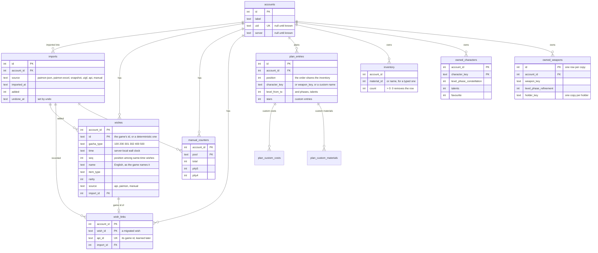

# Storage: the data folder, SQLite, backups, snapshots

Everything the player enters or imports is in one folder, and the database in it is the single source of truth.
This page is the "how"; the rules themselves (non-negotiable) are in `CLAUDE.md` under "Data-safety rules".

## The data folder

```text
<root>/wishes.db            the database
<root>/wishes.db-wal, -shm  SQLite's write-ahead log
<root>/.lock                held while a process has the folder open
<root>/backups/             automatic and manual backups of the database
<root>/imports/             a copy of every imported file, as received
<root>/game-data/           optional newer game data (items.json, banners.json, planner.json, archive.json)
<root>/cache/images/        the game's images, downloaded on first use (and blur/ for the backdrops)
<root>/settings.json        this computer's preferences
```

`AppPaths` (`crates/wish-core/src/paths.rs`) names each. The root is the OS data folder
(`~/.local/share/genshin-companion`, `%APPDATA%\genshin-companion\data`,
`~/Library/Application Support/genshin-companion`), or the folder `GENSHIN_COMPANION_DATA_DIR` names (the former `GENSHIN_WISHES_DATA_DIR` still works). On the first start after the
rename, a former `genshin-wishes` folder is copied (`copy_data_folder`) and left as it was.

**One process at a time.** `AppPaths::lock` takes `.lock`; a second app start says the app is already open, and
`wishctl`'s writing commands stop. A folder that can't be locked (some network drives) still opens.

**Every file written outside the database** goes through `write_atomic`: a temporary file, fsync, rename, fsync of
the folder. Readers see the old file or the new one, never half.

## The database

`Store` (`crates/wish-core/src/store/`) opens it with WAL, `synchronous = FULL`, foreign keys on, and
`trusted_schema` off. Every table is `STRICT`.



What the tables hold:

- **`wishes`**: each wish as its source recorded it, never a computed value (pity, banner, 50/50 are worked out
  again from these rows: [wishes.md](wishes.md)). Its id is the game's for wishes from the game, else a
  deterministic one (`WishId::paimon`, `manual`, `made_up`), so the same file imported twice gives the same ids.
- **`wish_links`**: a migrated wish (from paimon.moe, which kept no game id) gets its game id here once an import
  from the game recognises it; the wish itself is never rewritten.
- **`imports`**: one row per account per import, the log Settings shows. Undo marks it `undone_at`, never deletes
  it.
- **`manual_counters`**: counters paimon.moe's manual mode typed by hand, kept as they were.
- **`plan_entries`**, **`plan_custom_costs`**, **`plan_custom_materials`**: each account's plan, in order. Costs are
  never stored: they come from the game data each time.
- **`inventory`**: what each account has, by material id, or by name for a material the game data lacks.
- **`owned_characters`**, **`owned_weapons`**: the collection. A character holds at most one weapon copy (a unique
  partial index).

| Store's files | Methods |
| --- | --- |
| `crates/wish-core/src/store/mod.rs` | `open` (migrate, back up), `take_changed` |
| `crates/wish-core/src/store/accounts.rs` | `accounts`, `add_account`, `identify_account`, `rename_account`, `remove_account` |
| `crates/wish-core/src/store/wishes.rs` | `wishes`, `manual_counters`, `links`, `known_api_ids`, `delete_manual_wishes` |
| `crates/wish-core/src/store/import.rs` | `apply_import`, `undo_import`, `recent_imports` |
| `crates/wish-core/src/store/plan.rs`, `inventory.rs` | the plan and the inventory, one transaction per write |
| `crates/wish-core/src/store/collection.rs` | the collection, `sync_targets`, `apply_sync`, `apply_good` |
| `crates/wish-core/src/store/merge.rs` | a snapshot's collection, plan and inventory merged in |
| `crates/wish-core/src/store/backup.rs` | backups, pruning, restore |

### What a write tells the app

`Store::take_changed` returns which accounts' analyses the writes since the last call may have changed: their
wishes, manual counters or server (`Changed::Accounts`), or `Changed::All` once opened or after a restore. A write
that changes one of those calls `Store::changed`, or the app keeps a stale analysis.

### Migrations

`crates/wish-core/src/store/schema/NNN_*.sql`, listed in `MIGRATIONS` in `crates/wish-core/src/store/mod.rs`.
`PRAGMA user_version` counts those that ran. Each runs in its own transaction, after a `before-migration` backup.

| Migration | What it added |
| --- | --- |
| `001_initial.sql` | accounts, imports, wishes, manual counters |
| `002_links_and_undo.sql` | wish links, `imports.undone_at`, the counters' `import_id` |
| `003_planner.sql` | the plan and custom costs |
| `004_inventory_and_custom_characters.sql` | the inventory, custom characters' materials |
| `005_planner_weapons.sql` | weapon entries |
| `006_planner_custom_weapons.sql` | custom weapons |
| `007_collection.sql` | the collection; plan and inventory per account |

Never edit a migration that shipped: add the next one and append it. A database with a newer `user_version` is
refused untouched (`Error::SchemaTooNew`): it was written by a newer app.

## Backups

`backups/wishes-<UTC time>Z-<reason>.db`, made with SQLite's backup API, so each is a complete database.

| Reason | When |
| --- | --- |
| `before-import`, `before-sync` | before an import, a HoYoLAB sync or a GOOD import |
| `before-undo`, `before-restore`, `before-delete`, `before-removing-account` | before undoing an import, restoring a backup, deleting wishes counted by hand, removing an account |
| `before-migration` | before the schema changes |
| `daily` | at the first open of a day |
| `manual` | Settings → Back up now |
| `before-counting`, `before-planning` | counting by hand, editing the plan or the collection: at most one an hour each |

The hourly ones are kept apart (the newest `KEEP_HOURLY_BACKUPS`, 10) from the others (the newest `KEEP_BACKUPS`,
30), so a long session of clicks can't push the backups of real imports out. Backups sort by the instant in their
name; older names in local time without the `Z` still read.

**Restoring** replaces the whole database with a backup, after a `before-restore` backup of the current one. A file
holding a trigger or a view is refused: the app makes none, and one could act on the next import.

## Undo

Every row an import adds carries its `import_id`: wishes, links, manual counters. `undo_import` takes a backup,
deletes exactly those rows (and the links later imports recorded on the wishes going), and marks the import
undone. A snapshot's collection, plan and inventory carry no `import_id`, since they are merged rather than added:
undoing a snapshot import removes its wishes, and its `before-import` backup undoes the rest.

## Snapshots and the mirror

A snapshot (`crates/wish-core/src/snapshot.rs`) is the app's own lossless export: every account with its wishes,
manual counters, game ids, characters, weapons, plan and inventory. The collection, plan and inventory are written
as records of the format's own (`SnapshotCharacter`, `SnapshotPlanEntry`…), not the app's types, so changing a
type never changes the file.

- Format `genshin-wishes-snapshot` (the app's former name, kept so every file still reads), version 2; version 1
  (wishes only) still reads; a newer one is refused.
- Importing one merges it (`AccountBatch::extras`, `store/merge.rs`): characters and weapon copies added or raised,
  never lowered; plan entries not planned yet added; materials the account has none of added. The same snapshot
  twice changes nothing.
- The **mirror** is a snapshot written to a folder the player chose (synced by Syncthing, Nextcloud…), under one
  fixed name (`MIRROR_FILE`), a moment after the last change ([app-state.md](app-state.md)).

**Files written outside the database must keep reading.** `crates/wish-core/tests/formats.rs` reads the frozen
witnesses in `crates/wish-core/tests/fixtures/witness/` (a version 1 snapshot written by 0.5.0, version 2 by 0.6.0,
a `settings.json` of 0.6) and checks the writer still writes the current version. Never edit or regenerate a
witness: a format change gets a new version and a new witness written by the app that introduces it.

## `settings.json`

`Settings` (`crates/wish-core/src/settings.rs`): the mirror folder, the game folder, counting by hand, the resin
options, the language. They describe this computer, not the data, so they are not in the database or its
backups. A field added later gets `#[serde(default)]`. A file that doesn't parse is set aside as
`settings.json.<UTC time>.damaged` (the next save would otherwise replace it, and the mirror folder with it).

## When the app can't start

A failure before the main window, and every panic, goes to `genshin-companion-errors.txt` in the user's cache
folder (`paths::user_cache_dir`; readable by the user only, started over past 256 KiB), and before the window also
to a small window of its own (`crates/wish-app/src/startup_error.rs`): release builds on Windows have no console.
