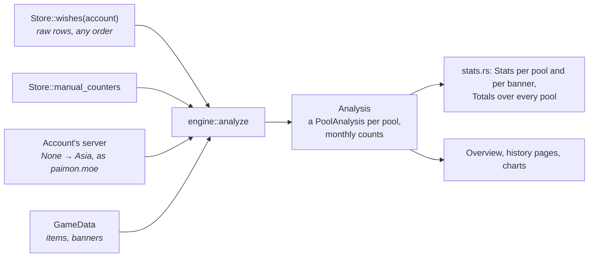

# The wish counter's engine

`crates/wish-core/src/engine.rs` works out everything about an account's wishes from the raw rows: each wish's
pity, the banner it fell on, its 50/50, each pool's counters and guarantees. It is a port of paimon.moe's
`processWishes` (`reference/src/routes/wish/import.svelte`), and **its numbers stay paimon.moe's**: that is the
acceptance test. Nothing it works out is ever stored; the app works it out again (`Library` keeps each account's
`Analysis` until a write changes what it reads: [app-state.md](app-state.md)).

## The domain's rules

| Gacha type | Banner type (`Pool`) | 5★ hard pity | Rate-up (50/50) |
| --- | --- | --- | --- |
| 100 | Beginners' Wish | 90 | no |
| 200 | Standard | 90 | no |
| 301 and 400 | Character Event (and Character Event-2): **one pool, shared pity** | 90 | yes |
| 302 | Weapon Event | 80 | yes |
| 500 | Chronicled Wish | 90 | not tracked (nor by paimon.moe) |

- 4★ pity is 10 on every pool. A wish costs 160 primogems.
- **Pity** counts the wishes since the previous item of the same rarity, this one included. A 5★ does not reset the
  4★ count. Pity typed by hand in paimon.moe's manual mode (`Wish::manual_pity`) is kept as typed.
- **50/50**, on Character and Weapon Event only: a 4★ or 5★ that isn't one of the banner's rate-up items
  (`featured` for 5★, `featured_rare` for 4★, by item key) loses, and the next one of that rarity is guaranteed. A
  rate-up item wins, unless it was guaranteed (`RateUpOutcome::Guaranteed`). A guaranteed item that isn't rate-up
  never happens in the game; it means the banner data doesn't match the wish (`LostWhileGuaranteed`).
- **Character banners that ran side by side** (Character Event and Character Event-2) are one entry in
  `Banners::character`, whose featured items the 50/50 reads, as paimon.moe does. `Banners::dual` keeps the two
  halves, for their own names (the spreadsheet export names the second's wishes after it).

## Banners and time

The game's API gives wish times as **server-local wall clock, without a time zone** (`WishTime`, kept exactly as
received). paimon.moe's banner times are UTC+8 wall clock. Server offsets: Asia, TW/HK/MO and China +8, America −5,
Europe +1 (no daylight saving time).

A banner's start or end flagged `timezone_dependent` (a version update) is one global instant written in UTC+8:
on another server it falls `8 − offset` hours earlier in local time. The others (a mid-version banner change) are
the same wall-clock time on every server. `Window::of` turns each banner into the account's local wall clock.

Walking the pool's wishes in time order, the current banner moves on once it has ended and a later banner covers
the wish; a wish no banner covers stays on the current one, as paimon.moe does (counted in `outside_banners`: many
of them mean the banner data is stale). A wish exactly at a banner's end stays on it.

## What the pages read

| Value | Where |
| --- | --- |
| Each wish's pity, banner, rate-up result | `PoolAnalysis::pulls` (`Pull`) |
| Each banner's slice of wishes, its number on the banner | `PoolAnalysis::banners`, `banner_rolls` |
| Wishes since the last 5★ and 4★, guarantees | `PoolAnalysis::counters`, `guarantee` (manual counters win when present) |
| Counts, shares, average pity, 50/50 record, streaks | `PoolAnalysis::stats` (`crates/wish-core/src/stats.rs`) |
| Over every pool | `Analysis::totals`, `Analysis::pulls_of(rarity)` |
| Per month | `Analysis::monthly` |

## The pages

**The Overview's Wishes tab** (`crates/wish-app/src/features/overview/wishes/`), top to bottom: the key figures
(`totals.rs`; two by two on a narrow page; `totals::figures` is the card the three tabs share), one card per banner
type (`pool_card.rs`: its latest banner and a link to its history, 5★ and 4★ pity with the next one's odds, then
`details.rs`, paimon.moe's per-type summary, and every 5★ as a pill coloured by pity), then the charts: wishes, 4★
and 5★ per month as overlaid areas (`monthly_chart.rs`), and each 5★'s pity in time order (`wish_ui::pity_chart`).
Everything about a banner type stays in its one card. The cards go as many a row as fit (`POOL_CARD_REMS` each) in
even rows (four as two by two, `even_columns`) and stretch to the row's tallest; the charts sit side by side (two
thirds, one third) or stack, at a fixed height (`CHART_REMS`).

**A banner type's history** (`crates/wish-app/src/features/wishes/history/`): `model.rs` builds the rows, cells,
sort and subtitle as pure functions tested on the sample save. `table.rs` draws them with the kit's table: rows
4 rem tall with the item's icon at 3 rem (the user's choice, `ROW_REMS`), each cell centred; sort by any column
(kept in the delegate, so `TableState::refresh` keeps it); pages of 25/50/100; a "Type" column (rarity and
character or weapon) and a "#" column (the wish's number on its banner); 4★ and 5★ rows tinted from `render_tr`.
The widths add up to 60.5 rem so the table fits a 1280 px window; on a wider one the card measures itself
(`on_prepaint`) and the item and banner columns share the room. `charts.rs`: the rarity donut, wishes per banner,
each 5★'s pity; the strip hides on windows under 50 rem high, since the table scrolls on its own. `banners.rs`: the
banner view, the 5★ history then a grid of banner cards. `manual_counting.rs`: +1/+10 and "Add a 4★ or 5★".

## The acceptance tests

- `crates/wish-core/tests/engine.rs`: golden tests on `crates/wish-core/tests/fixtures/paimon-sample.json` and
  `paimon-engine.json` (an America account with a pull between two banners). Their stored values follow paimon.moe's
  rules; keep them that way.
- `import/paimon_check.rs` runs the engine on a paimon.moe save and compares every pull's pity and 50/50 and every
  counter with what paimon.moe stored in it; the import preview shows the result, and `wishctl check-paimon <file>`
  prints it. No difference means this app shows paimon.moe's numbers.
- `crates/wish-core/tests/import.rs` also runs on real exports placed in `crates/wish-core/tests/fixtures/private/`
  (git-ignored: they hold UIDs).

When porting more of paimon.moe, keep its numbers first, then improve. A deliberate difference gets a comment at
the spot (as the wish before the first banner, which paimon.moe would crash on and which gets no 50/50 here).
